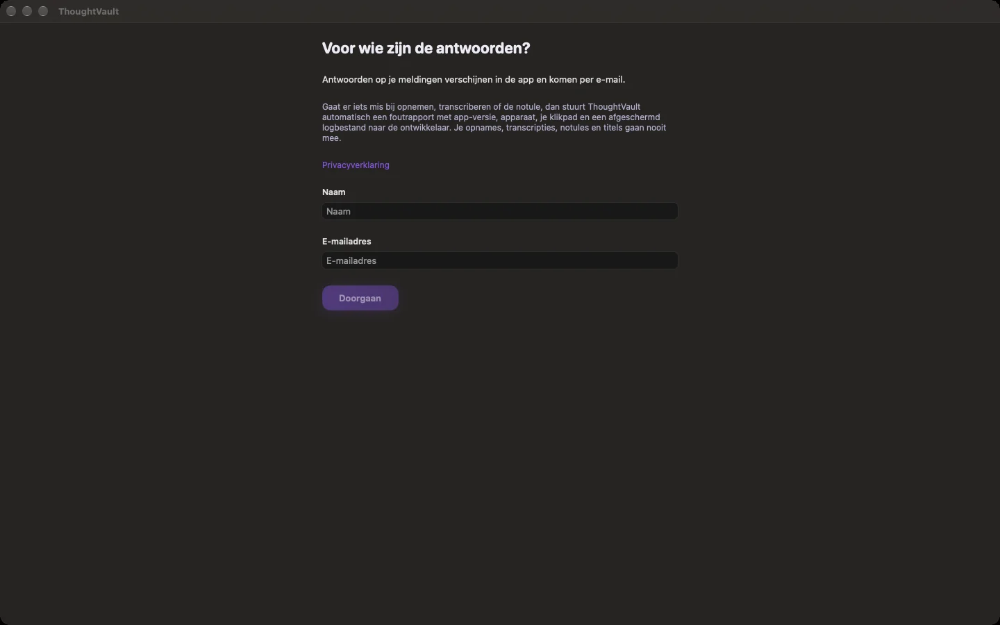
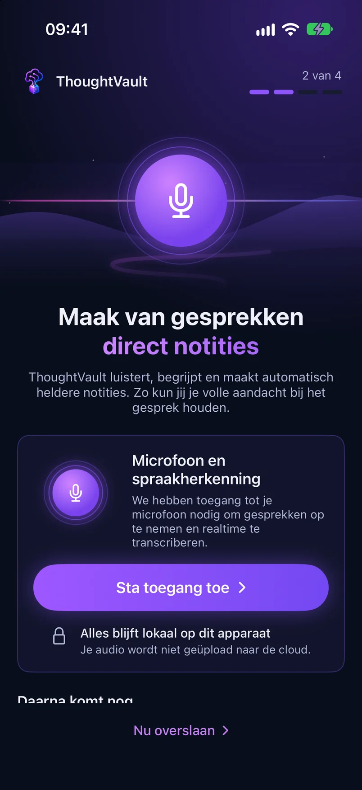

groep: Beginnen
samenvatting: Je installeert ThoughtVault, doorloopt de eerste start en geeft de toestemmingen die nodig zijn om op te nemen.

# Aan de slag

Na de eerste start vraagt ThoughtVault om je naam en e-mailadres en, op Mac, iPhone en iPad, om een paar toestemmingen. Daarna kun je opnemen. Voor het schrijven van notulen moet er nog een AI-model zijn ingesteld: zie [Voor je eerste notulen](#voor-je-eerste-notulen).

## Installeren

::: macos ios
Je installeert ThoughtVault via TestFlight, de app van Apple voor het testen van apps. Nieuwe versies komen ook via TestFlight binnen.
:::

::: windows
Je installeert ThoughtVault met het installatieprogramma. De app werkt zichzelf daarna bij.
:::

## Naam en e-mailadres invullen

Het eerste scherm vraagt wie je bent. De ontwikkelaar gebruikt deze gegevens om op je meldingen te antwoorden. Het scherm legt ook uit welke gegevens een automatisch foutrapport bevat.

1. Vul je **Naam** in.
2. Vul je **E-mailadres** in.
3. Klik op **Doorgaan**.

**Doorgaan** werkt pas als beide velden zijn ingevuld en het e-mailadres geldig is. Je naam mag maximaal 200 tekens lang zijn, je e-mailadres 320. Via **Privacyverklaring** open je de privacyverklaring in je browser.

::: macos ios
Het scherm heet **Voor wie zijn de antwoorden?**. Antwoorden op je meldingen verschijnen in de app en komen per e-mail.
:::

::: windows
Het scherm heet **Even voorstellen**. Het automatisch versturen van foutrapporten zet je uit bij **Instellingen** > **Account**.
:::

::: macos

:::

## De eerste start doorlopen

::: macos
Na je naam en e-mailadres volgt een reeks van zeven schermen. Met **Volgende** ga je verder, met **Terug** een scherm terug.

| Scherm | Wat je doet |
|--------|-------------|
| **Welkom bij ThoughtVault** | Klik op **Beginnen**. |
| **Microfoon** | Klik op **Toegang verlenen** en bevestig de vraag van macOS. Zonder deze toestemming kun je niet opnemen. |
| **Spraakherkenning** | Klik op **Toegang verlenen**. Deze toestemming is nodig voor transcriptie met Apple Spraakherkenning. |
| **Agenda** | Kies **Apple Agenda** om de agenda's van je Mac te gebruiken, of klik op **Overslaan**. Staat **Microsoft 365** in de lijst, dan kun je daar met je werkaccount koppelen. |
| **Systeemaudio** | Hier hoef je niets te doen. macOS vraagt de toestemming zodra je voor het eerst het geluid van je computer opneemt. |
| **Vertel iets over jezelf** | Vul in wat je kwijt wilt, of klik op **Overslaan**. Zie [Vertel iets over jezelf](#vertel-iets-over-jezelf). |
| **Je bent klaar!** | Je ziet per toestemming of die is verleend. Klik op **Maak je eerste opname**. |

Heb je een toestemming geweigerd, dan toont het scherm de knop **Systeeminstellingen openen**. Daar zet je de toestemming alsnog aan.

Na **Maak je eerste opname** opent het scherm **Opnemen**.

:::

::: ios
Na je naam en e-mailadres volgen vier genummerde stappen. Bovenaan zie je waar je bent, bijvoorbeeld "2 van 4".

1. Tik op het welkomstscherm op **Beginnen**.
2. Tik bij **Microfoon en spraakherkenning** op **Sta toegang toe** en bevestig de vragen van iOS. Met **Nu overslaan** ga je verder zonder toestemming, maar dan kun je niet opnemen.
3. Kies bij **Agenda** hoe je je agenda koppelt, of tik op **Overslaan**.
4. Vul bij **Vertel iets over jezelf** in wat je kwijt wilt, of tik op **Overslaan**.
5. Tik op het scherm **Je bent klaar!** op **Maak je eerste opname**.

Heb je de toegang tot de microfoon geweigerd, dan toont stap 2 de knop **Instellingen openen**. Daar zet je de toestemming alsnog aan.

:::

::: windows
Na **Doorgaan** opent meteen het scherm **Home**. Zolang je lokaal werkt, en dat is de standaard, volgt er geen installatiewizard.

Toegang tot de microfoon regelt Windows zelf: de controle vindt plaats op het moment dat je een opname start. Wil je het vooraf nakijken, klik dan op **Home** in het kaartje **Nieuwe opname** op **Toegang beheren**. Dat opent de microfooninstellingen van Windows.

Werk je met een ThoughtVault-account en de verwerking **Cloud**, dan volgt na het inloggen eenmalig een wizard met de stappen Welkom, Server, Microfoon, Agenda, Profiel en Klaar.
:::

## Vertel iets over jezelf

::: macos ios
Dit scherm van de eerste start heeft zes velden: **Naam**, **Rol / Functie**, **Organisatie**, **Hoe noemen collega's jou?**, **Typische vergadertypen** en **Expertise / onderwerpen**. ThoughtVault gebruikt ze om actiepunten in de notulen aan de juiste persoon te koppelen. Meerdere waarden in een veld scheid je met een komma. Laat je alles leeg, dan wordt er niets opgeslagen.
:::

::: windows
Bij lokaal werken slaat Windows deze vraag over. De velden staan alleen in de wizard die je na het inloggen in de modus **Cloud** te zien krijgt.
:::

## Toestemmingen in een oogopslag

::: macos
| Toestemming | Waarvoor | Wanneer gevraagd |
|-------------|----------|------------------|
| Microfoon | Elke opname | Tijdens de eerste start |
| Spraakherkenning | Transcriptie met Apple Spraakherkenning | Tijdens de eerste start |
| Agenda | Je vergaderingen van vandaag tonen en een melding vlak voor een vergadering | Tijdens de eerste start, als je **Apple Agenda** kiest |
| Systeemaudio | Het geluid van je computer opnemen bij een videocall | Bij je eerste opname met systeemgeluid |

Ontbreekt er een toestemming, dan staat bovenaan het venster de balk **Ontbrekende rechten** met per toestemming een knop **Toestaan** of **Open Systeeminstellingen**. Na het verlenen kan een herstart van de app nodig zijn.
:::

::: ios
iPhone en iPad vragen om microfoon, spraakherkenning en, als je je agenda koppelt, toegang tot je agenda. Systeemgeluid opnemen kan op deze apparaten niet.
:::

::: windows
Windows controleert alleen de toegang tot de microfoon. De app zelf vraagt geen aparte toestemming voor het geluid van je computer.
:::

## Voor je eerste notulen

::: macos windows
Voor de notulen zoekt de app standaard naar Ollama op je eigen computer. Draait daar geen model, dan eindigt de taak met een fout over de notulen. De transcriptie is dan wel bewaard, zodat je de notulen later opnieuw kunt laten maken.
:::

::: ios
Op een iPhone of iPad die Apple Intelligence ondersteunt, schrijft dat model standaard de notulen. Op andere apparaten staat de keuze op Ollama en stel je zelf een aanbieder in. Lukt het schrijven niet, dan eindigt de taak met een fout over de notulen. De transcriptie is dan wel bewaard.
:::

Kijk daarom voor je eerste opname de instellingen na:

1. Open **Instellingen**.
2. Ga naar **Verwerking**.
3. Controleer onder **Transcriptie** dat lokale verwerking is gekozen.
4. Kies onder **Notulen** het AI-model dat de notulen schrijft.

De keuzes op dit scherm staan beschreven in [Instellingen](instellingen.html). Wat elke keuze betekent voor je gegevens lees je in [Lokaal of via de cloud verwerken](lokaal-of-cloud.html).
