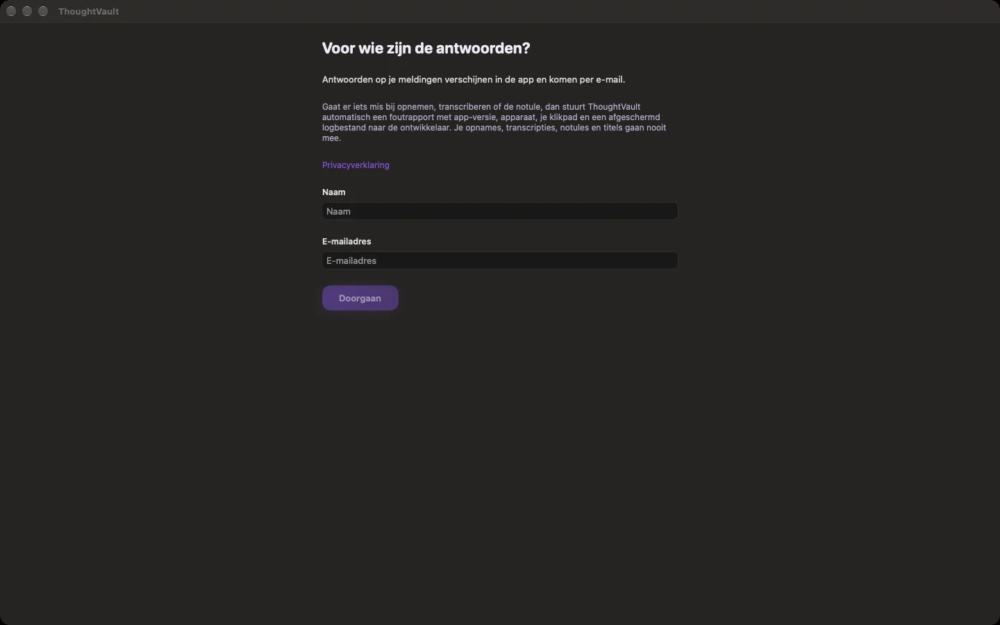
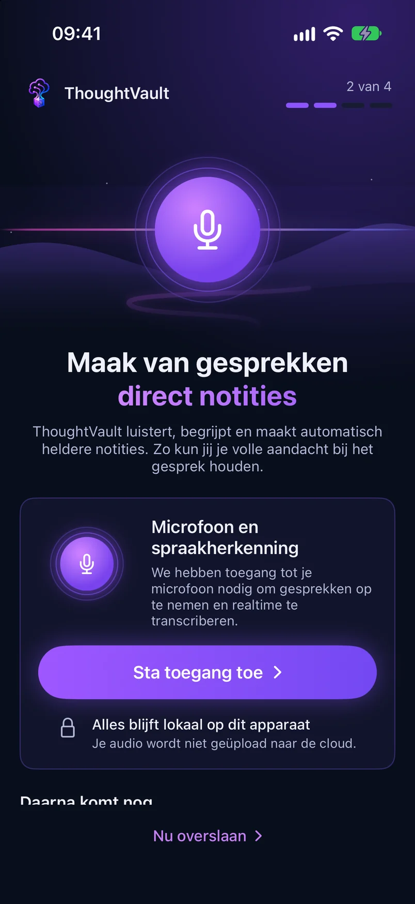
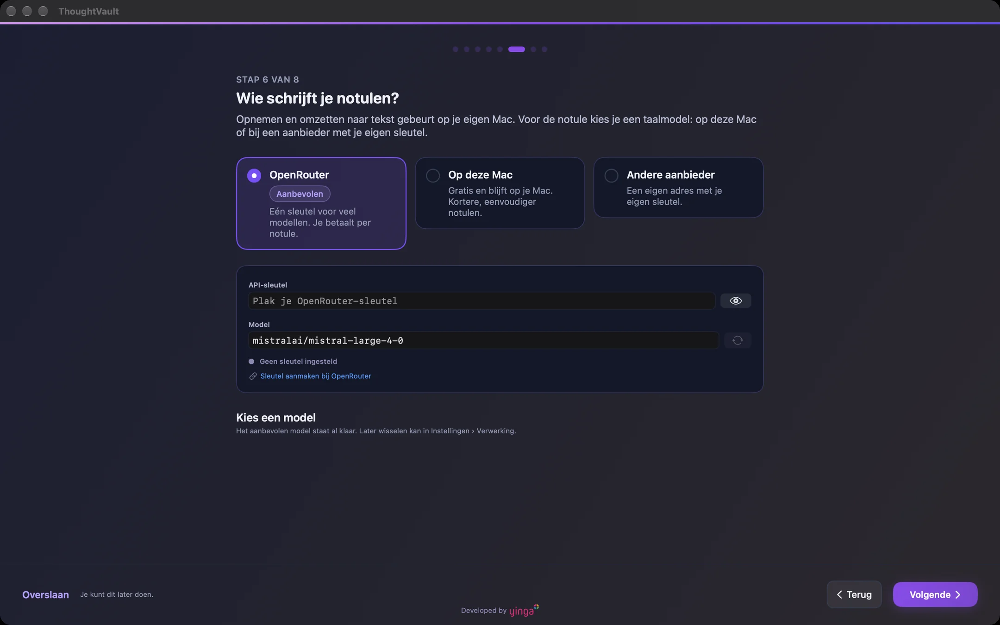
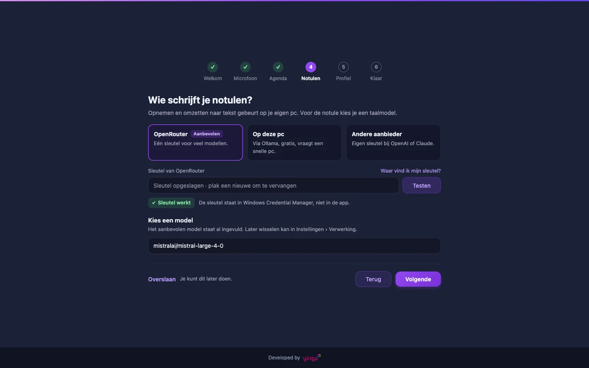

groep: Beginnen
samenvatting: Je installeert ThoughtVault, doorloopt de eerste start en geeft de toestemmingen die nodig zijn om op te nemen.

# Aan de slag

Na de eerste start vraagt ThoughtVault om je naam en e-mailadres en, op Mac, iPhone en iPad, om een paar toestemmingen. Daarna kies je wie je notulen schrijft en kun je opnemen. Sla je die keuze over, dan maakt de app pas notulen als je een model instelt: zie [Voor je eerste notulen](#voor-je-eerste-notulen).

## Installeren

::: macos ios
Je installeert ThoughtVault via TestFlight, de app van Apple voor het testen van apps. Nieuwe versies komen ook via TestFlight binnen.
:::

::: windows
Je installeert ThoughtVault met het installatieprogramma. De app werkt zichzelf daarna bij.
:::

## Naam en e-mailadres invullen

Het eerste scherm vraagt wie je bent. De ontwikkelaar gebruikt deze gegevens om op je meldingen te antwoorden. Het scherm legt ook uit welke gegevens een automatisch foutrapport bevat.

1. Vul je **Naam** in.
2. Vul je **E-mailadres** in.
3. Klik op **Doorgaan**.

**Doorgaan** werkt pas als beide velden zijn ingevuld en het e-mailadres geldig is. Je naam mag maximaal 200 tekens lang zijn, je e-mailadres 320. Via **Privacyverklaring** open je de privacyverklaring in je browser.

::: macos ios
Het scherm heet **Voor wie zijn de antwoorden?**. Antwoorden op je meldingen verschijnen in de app en komen per e-mail.
:::

::: windows
Het scherm heet **Even voorstellen**. Het automatisch versturen van foutrapporten zet je uit bij **Instellingen** > **Account**.
:::

::: macos

:::

## De eerste start doorlopen

::: macos
Na je naam en e-mailadres volgt een reeks van acht schermen. Met **Volgende** ga je verder, met **Terug** een scherm terug.

| Scherm | Wat je doet |
|--------|-------------|
| **Welkom bij ThoughtVault** | Klik op **Beginnen**. |
| **Microfoon** | Klik op **Toegang verlenen** en bevestig de vraag van macOS. Zonder deze toestemming kun je niet opnemen. |
| **Spraakherkenning** | Klik op **Toegang verlenen**. Deze toestemming is nodig voor transcriptie met Apple Spraakherkenning. |
| **Agenda** | Kies **Apple Agenda** om de agenda's van je Mac te gebruiken, of klik op **Overslaan**. Staat **Microsoft 365** in de lijst, dan kun je daar met je werkaccount koppelen. |
| **Systeemaudio** | Hier hoef je niets te doen. macOS vraagt de toestemming zodra je voor het eerst het geluid van je computer opneemt. |
| **Wie schrijft je notulen?** | Kies wie de notulen schrijft en vul zo nodig je sleutel in. Zie [Notulen instellen](#notulen-instellen). |
| **Vertel iets over jezelf** | Vul in wat je kwijt wilt, of klik op **Overslaan**. Zie [Vertel iets over jezelf](#vertel-iets-over-jezelf). |
| **Je bent klaar!** | Je ziet per toestemming of die is verleend. Klik op **Maak je eerste opname**. |

Heb je een toestemming geweigerd, dan toont het scherm de knop **Systeeminstellingen openen**. Daar zet je de toestemming alsnog aan.

Na **Maak je eerste opname** opent het scherm **Opnemen**.

:::

::: ios
Na je naam en e-mailadres volgen vijf genummerde stappen. Bovenaan zie je waar je bent, bijvoorbeeld "2 van 5".

1. Tik op het welkomstscherm op **Beginnen**.
2. Tik bij **Microfoon en spraakherkenning** op **Sta toegang toe** en bevestig de vragen van iOS. Met **Nu overslaan** ga je verder zonder toestemming, maar dan kun je niet opnemen.
3. Kies bij **Agenda** hoe je je agenda koppelt, of tik op **Overslaan**.
4. Kies bij **Wie schrijft je notulen?** wie de notulen schrijft en tik op **Volgende**. Zie [Notulen instellen](#notulen-instellen).
5. Vul bij **Vertel iets over jezelf** in wat je kwijt wilt, of tik op **Overslaan**.
6. Tik op het scherm **Je bent klaar!** op **Maak je eerste opname**.

Heb je de toegang tot de microfoon geweigerd, dan toont stap 2 de knop **Instellingen openen**. Daar zet je de toestemming alsnog aan.

:::

::: windows
Na **Doorgaan** volgt eenmalig een wizard met de stappen Welkom, Microfoon, Agenda, Notulen, Profiel en Klaar. Met **Volgende** ga je verder, met **Vorige** of **Terug** een stap terug. Bij de stap Notulen kies je wie de notulen schrijft: zie [Notulen instellen](#notulen-instellen).

Toegang tot de microfoon regelt Windows zelf: de controle vindt plaats op het moment dat je een opname start. Wil je het vooraf nakijken, klik dan op **Home** in het kaartje **Nieuwe opname** op **Toegang beheren**. Dat opent de microfooninstellingen van Windows.

Had je ThoughtVault al geïnstalleerd voordat de stap Notulen bestond en werk je lokaal, dan zie je de wizard niet meer.
:::

## Vertel iets over jezelf

::: macos ios
Dit scherm van de eerste start heeft zes velden: **Naam**, **Rol / Functie**, **Organisatie**, **Hoe noemen collega's jou?**, **Typische vergadertypen** en **Expertise / onderwerpen**. ThoughtVault gebruikt ze om actiepunten in de notulen aan de juiste persoon te koppelen. Meerdere waarden in een veld scheid je met een komma. Laat je alles leeg, dan wordt er niets opgeslagen.
:::

::: windows
Dezelfde zes velden staan in de wizard bij de stap Profiel. Laat je alles leeg, dan wordt er niets opgeslagen.
:::

## Notulen instellen

Het scherm **Wie schrijft je notulen?** biedt drie keuzes.

::: macos ios
- **OpenRouter** (aanbevolen): één sleutel voor veel modellen. Je betaalt per notule bij OpenRouter. Plak je sleutel bij **API-sleutel**, klik op de knop naast **Model** om de sleutel te testen en de modellen te laden. Het aanbevolen model staat al ingevuld.
- **Op deze Mac** of **Op deze iPhone**: gratis, en de notule blijft op je apparaat. Apple Intelligence schrijft dan de notule. Is dat niet beschikbaar, dan gebruikt de Mac Ollama; op een iPhone kies je dan later een eigen server.
- **Andere aanbieder**: een eigen adres met je eigen sleutel.

Je sleutel staat in je sleutelhanger. Weigert OpenRouter de sleutel, dan zie je **OpenRouter weigert deze sleutel**. Controleer dan of je hem volledig hebt geplakt.
:::

::: windows
- **OpenRouter** (aanbevolen): één sleutel voor veel modellen. Plak je sleutel en klik op **Testen**. Werkt hij, dan zie je **Sleutel werkt**. Het aanbevolen model staat al ingevuld onder **Kies een model**.
- **Op deze pc**: Ollama op je eigen pc, gratis, maar het vraagt een snelle pc. Installeer Ollama en kies het model later bij **Instellingen** > **Verwerking**.
- **Andere aanbieder**: je eigen sleutel bij OpenAI of Claude.

Je sleutel staat in Windows Credential Manager. Weigert de aanbieder de sleutel, dan zegt de app dat; is de aanbieder niet bereikbaar, dan vraagt de app je de internetverbinding te controleren.
:::

Met **Overslaan** vraagt de app eerst **Zonder taalmodel verder?**. Kies **Model kiezen** om terug te gaan, of **Toch overslaan**. Opnemen en omzetten naar tekst werken daarna gewoon, maar notulen maakt de app pas als je een model kiest bij **Instellingen** > **Verwerking**. Klik je op **Volgende** zonder sleutel, dan krijg je dezelfde vraag.

::: macos

:::

::: windows

:::

## Toestemmingen in een oogopslag

::: macos
| Toestemming | Waarvoor | Wanneer gevraagd |
|-------------|----------|------------------|
| Microfoon | Elke opname | Tijdens de eerste start |
| Spraakherkenning | Transcriptie met Apple Spraakherkenning | Tijdens de eerste start |
| Agenda | Je vergaderingen van vandaag tonen en een melding vlak voor een vergadering | Tijdens de eerste start, als je **Apple Agenda** kiest |
| Systeemaudio | Het geluid van je computer opnemen bij een videocall | Bij je eerste opname met systeemgeluid |

Ontbreekt er een toestemming, dan staat bovenaan het venster de balk **Ontbrekende rechten** met per toestemming een knop **Toestaan** of **Open Systeeminstellingen**. Na het verlenen kan een herstart van de app nodig zijn.
:::

::: ios
iPhone en iPad vragen om microfoon, spraakherkenning en, als je je agenda koppelt, toegang tot je agenda. Systeemgeluid opnemen kan op deze apparaten niet.
:::

::: windows
Windows controleert alleen de toegang tot de microfoon. De app zelf vraagt geen aparte toestemming voor het geluid van je computer.
:::

## Voor je eerste notulen

Heb je bij de eerste start een aanbieder gekozen, dan kun je meteen opnemen. Heb je de stap overgeslagen, dan staat de keuze op OpenRouter zonder sleutel. Een opname eindigt dan met een fout over de notulen. De transcriptie is wel bewaard, zodat je de notulen later opnieuw kunt laten maken.

Kies dan alsnog een model:

1. Open **Instellingen**.
2. Ga naar **Verwerking**.
3. Controleer onder **Transcriptie** dat lokale verwerking is gekozen.
4. Kies onder **Notulen** het AI-model dat de notulen schrijft.

De keuzes op dit scherm staan beschreven in [Instellingen](instellingen.html). Wat elke keuze betekent voor je gegevens lees je in [Lokaal of via de cloud verwerken](lokaal-of-cloud.html).
