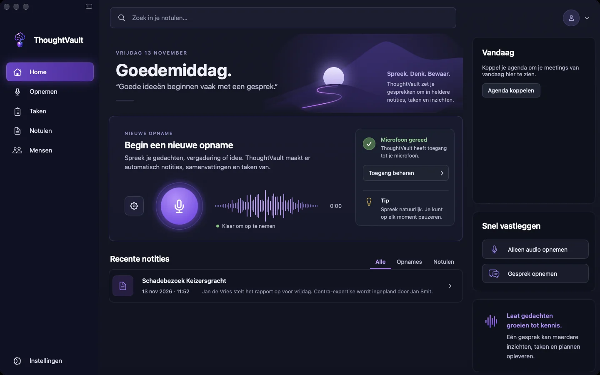
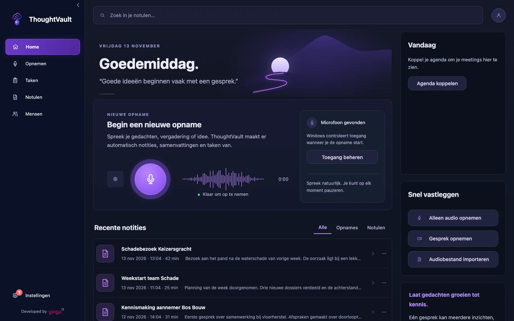
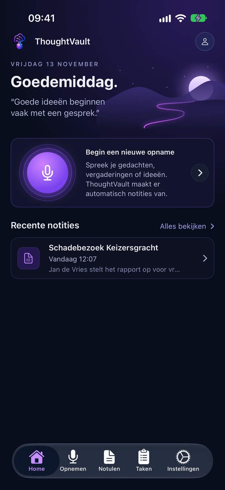

groep: Beginnen
samenvatting: Je vindt op Home de snelste weg naar een nieuwe opname, je recente notulen en je vergaderingen van vandaag.

# Het startscherm (Home)

**Home** opent als je de app start. Bovenaan staat een begroeting die past bij het tijdstip (Goedemorgen, Goedemiddag of Goedenavond) met de datum van vandaag. Daaronder start je een opname en zie je wat je het laatst hebt vastgelegd.

::: macos

:::

::: windows

:::

::: ios

:::

## Een opname starten vanaf Home

::: macos
Het kaartje **Nieuwe opname** heeft een ronde microfoonknop. Een klik daarop opent het scherm **Opnemen** en start meteen een opname van je microfoon en het geluid van je computer.

Rechts in het venster staat **Snel vastleggen** met kortere routes. Ook deze knoppen starten de opname direct:

| Knop | Wat er wordt opgenomen |
|------|------------------------|
| **Alleen audio opnemen** | Alleen je microfoon |
| **Spraak naar notitie** | Alleen je microfoon, met het profiel voor notities. De knop staat er alleen als dat profiel bestaat. |
| **Gesprek opnemen** | Je microfoon en het geluid van je computer |

Onder de microfoonknop staat **Klaar om op te nemen** of **Microfoontoegang nodig**. In het tweede geval geef je toegang via de knop **Toegang geven** of **Toegang beheren** in hetzelfde kaartje. Het tandwiel links van de microfoonknop opent **Instellingen**.

Is het venster smal, dan schuiven de kaartjes van de rechterkolom onder het kaartje **Nieuwe opname**.
:::

::: windows
Het kaartje **Nieuwe opname** heeft een ronde knop met de tekst **Nieuwe opname**. Een klik opent het scherm **Opnemen** met de bron **Gecombineerd** alvast gekozen. De opname begint pas als je daar op **Start opname** klikt.

Rechts in het venster staat **Snel vastleggen**:

| Knop | Wat er gebeurt |
|------|----------------|
| **Alleen audio opnemen** | Opent **Opnemen** met de bron **Microfoon** |
| **Gesprek opnemen** | Opent **Opnemen** met de bron **Gecombineerd** |
| **Audiobestand importeren** | Opent **Opnemen**, waar je bij **Snelle acties** het bestand kiest |

Loopt er al een opname, dan toont het kaartje **Je opname loopt** of **Je opname is gepauzeerd** en brengt de knop **Huidige opname** je terug naar die opname.

In hetzelfde kaartje zie je of Windows een microfoon heeft gevonden. **Toegang beheren** opent de microfooninstellingen van Windows. Het tandwiel opent **Instellingen**.
:::

::: ios
Tik op het kaartje **Begin een nieuwe opname**. Het scherm **Opnemen** opent en je start daar de opname met **Start opname**.
:::

## Recente notities

Onder **Recente notities** staan je laatste opnames en notulen, met de titel en het moment van opname. Een klik of tik op een regel opent die notule in **Notulen**.

::: macos windows
Rechts boven de lijst kies je wat je ziet:

- **Alle** toont alles.
- **Opnames** toont alleen wat nog geen notulen heeft, bijvoorbeeld een transcriptie waarvan het schrijven van de notulen is mislukt.
- **Notulen** toont alleen wat notulen heeft.

Bovenaan Home staat het zoekveld **Zoek in je notulen…**. Typ een zoekterm en druk op Enter: de app opent **Notulen** met die zoekopdracht.
:::

::: windows
Via de knop met de drie puntjes rechts van een regel verwijder je een opname. De app vraagt eerst om bevestiging. Verwijderen kan niet ongedaan worden gemaakt.
:::

::: ios
Home toont de drie meest recente. **Alles bekijken** opent het volledige overzicht in **Notulen**. Trek het scherm omlaag om de lijst te verversen.
:::

::: macos windows
Heb je nog niets opgenomen, dan staat hier een lege melding met de knop **Maak je eerste opname**.
:::

## Lopende verwerking

::: macos
Zolang er een opname wordt verwerkt, staat boven de recente notities het blok **Bezig met verwerken** met per taak de voortgang in procenten. De details staan op het scherm [Taken](taken.html).
:::

::: ios
Zolang er een opname wordt verwerkt, toont Home het blok **Wordt verwerkt** met het aantal actieve taken en per taak de stap die loopt. De details staan op het scherm [Taken](taken.html).
:::

::: windows
Home zelf toont geen voortgang. Die volg je op het scherm [Taken](taken.html).
:::

## Vandaag: je agenda

Het blok **Vandaag** toont je vergaderingen als je agenda is gekoppeld.

::: macos
Je ziet hoogstens vier vergaderingen van vandaag. Een vergadering die voorbij is krijgt een vinkje. Is er geen agenda gekoppeld, dan staat er de knop **Agenda koppelen**. Zijn er vandaag geen vergaderingen meer, dan lees je **Geen meetings meer vandaag.**
:::

::: windows
Je ziet hoogstens drie aankomende vergaderingen. Heeft een vergadering een deelnamelink, dan staat erbij de knop **Direct opnemen**: die opent **Opnemen** en start meteen een opname van microfoon en systeemgeluid. Zonder gekoppelde agenda staat er de knop **Agenda koppelen**, die **Instellingen** opent.
:::

::: ios
Bij elke vergadering van vandaag staat de knop **Start opname**. Die start direct een opname met je microfoon en koppelt de vergadering aan de opname.
:::

Hoe de app je vlak voor een vergadering waarschuwt, lees je in [Vergaderdetectie](vergaderdetectie.html).

## Naar je account of instellingen

::: macos
Rechtsboven staat de accountknop. Het menu daaronder bevat **Instellingen** en, als je bent ingelogd, **Uitloggen**.
:::

::: windows
De knop met het poppetje rechtsboven opent je account als je bent ingelogd, en anders **Instellingen**.
:::

::: ios
**Instellingen** staat in de tabbalk onderaan.
:::
