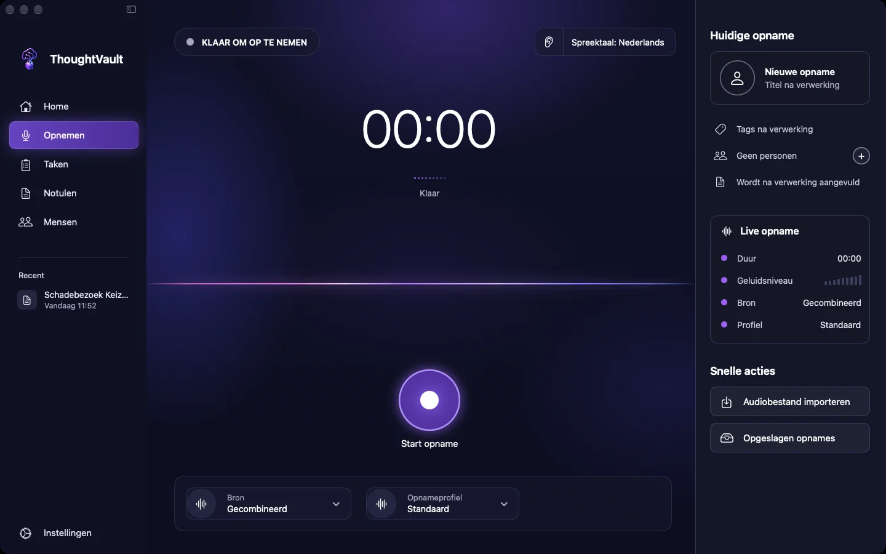
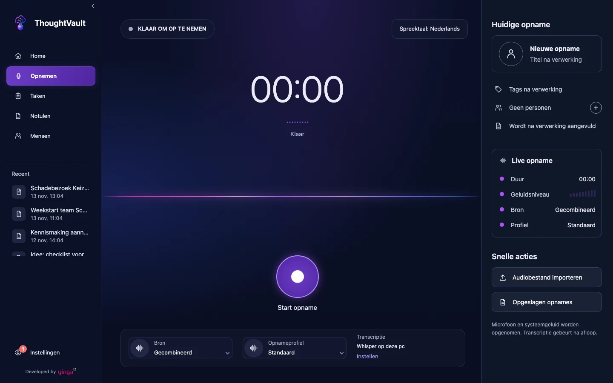
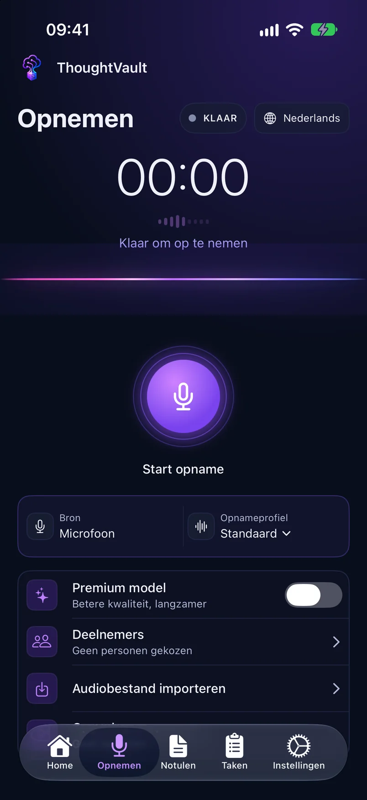

groep: Opnemen en verwerken
samenvatting: Je start een opname, kiest de bron en het profiel, pauzeert of stopt, en verwerkt een bestaand audiobestand of een bewaarde opname.
beeld: media/mac-opnemen.webp

# Opnemen

Op het scherm **Opnemen** maak je een opname, importeer je een audiobestand en vind je eerdere opnames terug. Bovenaan staat de status: **KLAAR OM OP TE NEMEN** zolang er niets loopt. De spreektaal is Nederlands.

::: macos

:::

::: windows

:::

::: ios

:::

## Het scherm openen

::: macos
Klik op **Opnemen** in de zijbalk, of druk op `Cmd+2` of `Cmd+R`.
:::

::: windows
Klik op **Opnemen** in de zijbalk, of druk op `Ctrl+2` of `Ctrl+N`.
:::

::: ios
Tik op **Opnemen** in de tabbalk onderaan.
:::

## Bron kiezen

De bron bepaalt welk geluid in de opname komt. Je kiest hem voor je start. Zodra de opname loopt ligt de bron vast.

::: macos
Klik in de balk onder de golfvorm op **Bron**:

| Keuze in het menu | Getoond als | Wat er wordt opgenomen |
|-------------------|-------------|------------------------|
| **Microfoon (fysieke meeting)** | Microfoon | Alleen je microfoon |
| **Microfoon + systeemgeluid (videocall)** | Gecombineerd | Je microfoon en alles wat je Mac afspeelt, dus ook de andere deelnemers van een videocall |

Bij je eerste opname met systeemgeluid vraagt macOS om toestemming. Lukt het samenvoegen van beide geluidsbronnen niet, dan meldt de app **Systeemaudio kon niet worden samengevoegd** en bevat de opname alleen het geluid van je microfoon.
:::

::: windows
Kies in de balk onder de golfvorm bij **Bron** tussen **Gecombineerd** (je microfoon en het geluid van je pc) en **Microfoon** (alleen je microfoon). Rechts onder **Snelle acties** staat in één zin wat er met de huidige keuze wordt opgenomen.
:::

::: ios
De bron is altijd **Microfoon**. Het geluid van andere apps opnemen kan op iPhone en iPad niet.
:::

## Profiel kiezen

Onder **Opnameprofiel** kies je het profiel waarmee de notulen worden geschreven. Je kunt het profiel nog wijzigen terwijl de opname loopt: de app leest de keuze pas uit op het moment dat je stopt. Wat een profiel doet, staat in [Profielen](profielen.html).

## Een opname starten en stoppen

1. Klik op **Start opname**.
2. Voer het gesprek.
3. Klik op **Stop en verwerk**.

Tijdens de opname staat bovenaan **OPNAME ACTIEF**. De tijd loopt en de golfvorm beweegt mee met het geluid. Na **Stop en verwerk** verschijnt de opname als taak op het scherm [Taken](taken.html).

::: macos ios
Een opname korter dan drie seconden wordt niet verwerkt. Je krijgt de melding **Opname is te kort (minimaal 3 seconden). Probeer opnieuw.**
:::

### Pauzeren, hervatten en annuleren

**Pauzeer** zet de opname stil. De tijd stopt en de status wordt **OPNAME GEPAUZEERD** (op iPhone en iPad: **GEPAUZEERD**). Met **Hervat** ga je verder in dezelfde opname.

::: macos
In de pauze heet de stopknop **Verstuur opname**: die stopt de opname en start de verwerking. Met **Annuleer** gooi je de opname weg. De app vraagt eerst **Opname annuleren?**. Kies **Annuleer opname** om hem te verwijderen of **Doorgaan met opnemen** om terug te gaan. Een geannuleerde opname is niet terug te halen.
:::

::: ios
In de pauze staan de knoppen **Hervat**, **Stop en verwerk** en **Annuleer**. **Annuleer** gooit de opname weg nadat je **Annuleer opname** hebt bevestigd. Een geannuleerde opname is niet terug te halen.
:::

::: windows
In de pauze staat onder **Snelle acties** de knop **Bewaar zonder verwerken**. Die stopt de opname zonder er een taak van te maken. De opname blijft staan bij **Opgeslagen opnames**, zodat je hem later alsnog kunt verwerken. Windows heeft geen knop om een lopende opname weg te gooien.
:::

### Een notitie toevoegen tijdens de opname

Met **Notitie** leg je tijdens het gesprek iets vast dat niet gezegd wordt, zoals een actiepunt of context. De notitie wordt op je apparaat bewaard en meegenomen in de notulen.

::: macos windows
1. Klik tijdens de opname op **Notitie**.
2. Typ je tekst in het veld **Snelle notitie**.
3. Klik op **Bewaar notitie**.
:::

::: ios
1. Tik tijdens de opname op **Notitie**.
2. Typ je tekst in het veld dat verschijnt.
:::

### Deelnemers aangeven

::: macos windows
Rechts onder **Huidige opname** staat hoeveel personen aan de opname zijn gekoppeld, standaard **Geen personen**. Klik op het plusje op die regel, of kies tijdens de opname **Deelnemers kiezen** bij **Snelle acties**, en selecteer wie aan het gesprek deelneemt. De namen komen uit **Mensen**.
:::

::: ios
Tik voor je start op **Deelnemers** en selecteer wie aan het gesprek deelneemt.
:::

## Live tekst tijdens de opname

Bij lokale verwerking, de standaard, wordt de opname pas na afloop omgezet naar tekst. Tijdens het opnemen zie je dan geen meelopende tekst.

::: macos ios
Meelopende tekst bestaat alleen als de verwerking op **Cloud** staat. Dan staat op het opnamescherm de schakelaar **Live transcriptie** (op iPhone en iPad: **Op apparaat**). Staat die aan en is spraakherkenning op het apparaat beschikbaar, dan verschijnt de herkende tekst tijdens het opnemen. De schakelaar ligt vast zolang een opname loopt.
:::

::: windows
Windows toont geen meelopende tekst. In de balk staat bij **Transcriptie** welk model de opname na afloop omzet, met de link **Instellen** naar **Instellingen**.
:::

## Een audiobestand importeren

Een gesprek dat al is opgenomen, bijvoorbeeld met een dictafoon of de spraakmemo's van je telefoon, verwerk je zonder het opnieuw af te spelen. Het bestand krijgt het profiel dat op dat moment bij **Opnameprofiel** staat.

::: macos
1. Kies het gewenste profiel bij **Opnameprofiel**.
2. Klik rechts bij **Snelle acties** op **Audiobestand importeren**.
3. Selecteer het bestand.

Je kunt ook een videobestand kiezen. De app haalt dan het geluid eruit.
:::

::: windows
1. Kies het gewenste profiel bij **Opnameprofiel**.
2. Klik rechts bij **Snelle acties** op **Audiobestand importeren**.
3. Selecteer het bestand.

Windows accepteert de bestandstypen wav, mp3, m4a, mp4, aac, flac en ogg.
:::

::: ios
1. Kies het gewenste profiel bij **Opnameprofiel**.
2. Tik op **Audiobestand importeren**.
3. Selecteer het bestand.
:::

De import verschijnt als taak op het scherm [Taken](taken.html), net als een eigen opname. De knop is er alleen als er geen opname loopt.

## Opgeslagen opnames

Elke opname en elk geïmporteerd bestand blijft als audiobestand op je apparaat staan. Onder **Opgeslagen opnames** vind je ze terug, met datum en bestandsgrootte. Je gebruikt deze lijst om een opname opnieuw te verwerken, bijvoorbeeld met een ander profiel of nadat de verwerking is mislukt.

::: macos
1. Klik bij **Snelle acties** op **Opgeslagen opnames**.
2. Klik op de opname.
3. Kies onder **Profiel** het profiel voor de notulen.
4. Klik op **Start verwerking**.

Een klik met de rechtermuisknop op een opname geeft **Opnieuw verwerken** en **Verwijderen**. Het mapje rechtsboven in de lijst (**Toon in Finder**) opent de map met de audiobestanden. De lijst toont de tien nieuwste opnames. Het getal achter **Opgeslagen opnames** bij **Snelle acties** telt de bewaarde opnames en de lopende taken samen.
:::

::: ios
1. Tik op **Opgeslagen opnames**.
2. Tik op de opname.
3. Kies onder **Profiel** het profiel voor de notulen.
4. Tik op **Start verwerking**.
:::

::: macos ios
Opnames die al zijn verwerkt, ruimt de app na zeven dagen zelf op. Een opname zonder transcriptie blijft staan tot je hem verwerkt of verwijdert.
:::

::: windows
1. Klik bij **Snelle acties** op **Opgeslagen opnames**.
2. Klik bij de opname op het icoon **Opnieuw verwerken**.

De verwerking gebruikt het standaardprofiel uit **Instellingen**, niet het profiel dat op het opnamescherm staat. Met het icoon **Verwijderen** haal je één opname weg. De knop **Opnames ouder dan 7 dagen verwijderen** ruimt in één keer alle oudere opnames op. Windows doet dat niet uit zichzelf.
:::

Verwijderen van een audiobestand is definitief. De notulen die er al van gemaakt zijn, blijven bestaan.

## Opnemen terwijl je in een andere app werkt

::: macos
### Het menubalkpictogram

ThoughtVault staat met een pictogram in de menubalk. Tijdens een opname kleurt het rood en staat de opnametijd ernaast, in de pauze is het oranje. Het menu toont de status, bijvoorbeeld **Opname bezig** of **Gepauzeerd**. Loopt er geen opname, dan staat er **Niet aan het opnemen**, of **Niet ingelogd** als je zonder account werkt. Daaronder staan deze opdrachten:

| Opdracht | Wanneer zichtbaar |
|----------|-------------------|
| **Start opname** (`Shift+Cmd+R`) | Als er geen opname loopt. Start met de bron en het profiel die op het opnamescherm staan. |
| **Pauzeer** of **Hervat** | Tijdens een opname |
| **Stop en upload** | Tijdens een opname. Doet hetzelfde als **Stop en verwerk**. |
| **Annuleer opname** | Tijdens een opname, na bevestiging |
| **Open ThoughtVault** | Altijd. Haalt het venster naar voren. |
| **Afsluiten** | Altijd |

Is je agenda gekoppeld, dan staan onder **Aankomende vergaderingen** de eerstvolgende drie. Een klik opent de deelnamelink van die vergadering.

### Het zwevende venster

Zolang een opname loopt of gepauzeerd is, staat rechtsonder op je hoofdscherm een klein venster dat boven alle andere apps blijft. Het toont **Rec** of **Pauze** en de opnametijd, met een knop om te pauzeren of te hervatten en de knop **Stop**. **Stop** stopt de opname en start de verwerking. Het venster verdwijnt als de opname klaar is.
:::

::: windows
Bij het starten van een opname opent een klein los venster: de opnamewidget. Daarin staan **REC** of **PAUZE**, een golfvorm en de opnametijd, met de knoppen **Pauzeren** of **Hervatten** en **Stop**. **Stop** stopt de opname en start de verwerking. Je versleept de widget naar een plek waar hij niet in de weg staat.

:::

::: ios
iPhone en iPad hebben geen menubalkpictogram of zwevend venster. Je bedient de opname op het scherm **Opnemen**.
:::

## Als starten niet lukt

::: macos ios
De melding **Microfoontoestemming geweigerd. Geef toegang via Instellingen.** betekent dat de app niet bij je microfoon mag. Zet de toestemming aan in de systeeminstellingen van je apparaat en start opnieuw.
:::

::: windows
Een fout bij het starten staat als melding boven de tijd. Controleer dan via **Home** > **Toegang beheren** of Windows de app bij de microfoon laat.
:::

Meer oorzaken en oplossingen staan in [Problemen oplossen](problemen-oplossen.html).
