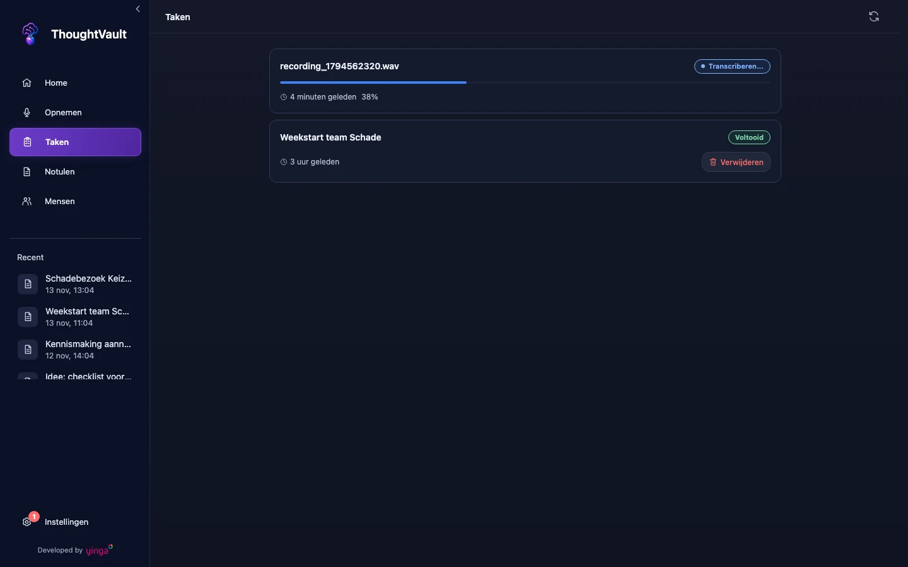
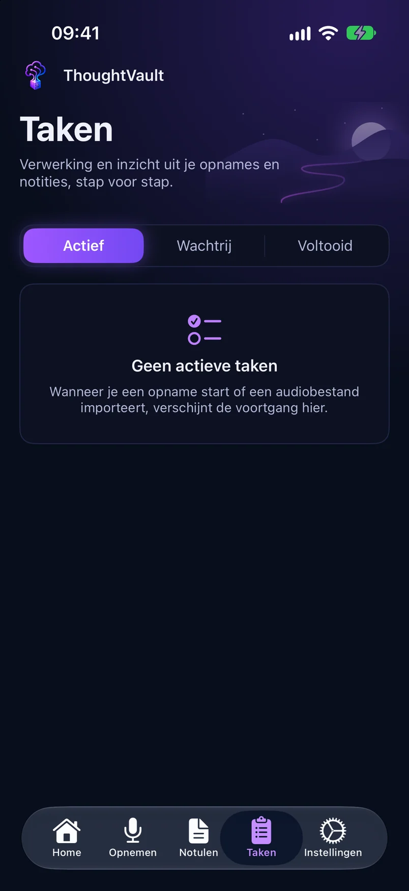

groep: Opnemen en verwerken
samenvatting: Je volgt hoe ver de verwerking van een opname is, leest wat de stapnamen betekenen en start een mislukte taak opnieuw.

# Taken

Elke opname die je stopt en elk audiobestand dat je importeert wordt een taak. Een taak zet eerst de audio om naar tekst en laat daarna de notulen schrijven. Het scherm **Taken** toont alle taken die lopen of zijn mislukt. Is er niets te doen, dan staat er **Geen actieve taken**.

::: windows

:::

::: ios

:::

## Wat je per taak ziet

::: macos
Elke regel toont de naam van het audiobestand, hoe lang geleden de taak is gestart (bijvoorbeeld **Zojuist** of **5 minuten geleden**), de status en een voortgangsbalk. Een taak die klaar is, krijgt de status **Voltooid** en verdwijnt na drie seconden uit de lijst. De notulen staan dan bij **Notulen**.

Dezelfde voortgang staat in een smalle balk bovenaan het venster, op elk scherm. Je hoeft **Taken** dus niet open te houden.
:::

::: windows
Elke kaart toont de titel of bestandsnaam, een statuslabel, hoe lang geleden de taak is gestart en de voortgang in procenten. Tijdens het schrijven van de notulen staat onder de titel de stap die op dat moment loopt.
:::

::: ios
Bovenaan kies je tussen **Actief**, **Wachtrij** en **Voltooid**. Elke kaart toont de voortgang in procenten en de stap die loopt. Tik op een lopende taak voor het scherm **Verwerken**, met de stappen **Transcriptie**, **Notulen genereren** en **Notulen opslaan** onder elkaar. Trek de lijst omlaag om te verversen.
:::

## De fasen van een taak

Bij lokale verwerking, de standaard, doorloopt een taak twee fasen.

::: macos ios
| Status | Wat er gebeurt |
|--------|----------------|
| **Transcriberen** | De audio wordt op je apparaat omgezet naar tekst. Loopt er al een transcriptie, dan staat er **Wacht op vorige transcriptie**. |
| Een stapnaam, zie hieronder | Het AI-model schrijft en controleert de notulen. |
| **Voltooid** | De notulen zijn opgeslagen. |
| **Fout** | De taak is gestopt met een fout. |
:::

::: windows
| Status | Wat er gebeurt |
|--------|----------------|
| **Transcriberen...** | De audio wordt op je pc omgezet naar tekst. |
| **Notulen genereren...** | Het AI-model schrijft en controleert de notulen. Onder de titel staat de stapnaam. |
| **Voltooid** | De notulen zijn opgeslagen. |
| **Mislukt** | De taak is gestopt met een fout. |
:::

De transcriptie wordt opgeslagen zodra ze klaar is, dus voordat de notulen worden geschreven. Mislukt het schrijven, dan hoeft de opname niet opnieuw te worden getranscribeerd.

Staat de verwerking op **Cloud**, dan zie je andere statussen, zoals **Uploaden**, **Converteren**, **In wachtrij** en **Verwerken**: de opname gaat dan naar de server en wordt daar verwerkt.

## De stapnamen bij het schrijven van de notulen

Het schrijven van notulen bestaat uit meerdere verzoeken aan het AI-model. De taak toont welk verzoek loopt.

| Stapnaam | Wat het model doet |
|----------|--------------------|
| **Concept schrijven** | De eerste versie van de notulen schrijven op basis van de transcriptie en je profiel. |
| **Samenvatten 2 van 5** | Een transcriptie die te lang is voor het model eerst in delen samenvatten. Het tweede getal is het aantal delen. |
| **Broncontrole** | Nagaan of de transcriptie zelf goed te volgen is. Deze controle start tegelijk met het concept en levert hoogstens een waarschuwing bij de notulen op. |
| **Inhoudscontrole** | In twee richtingen vergelijken: staat wat is gezegd in de notulen, en is wat in de notulen staat ook gezegd. |
| **Dekkingscontrole 3 van 8** | Bij een lang gesprek: per deel van de transcriptie nagaan of de notulen het dekken. |
| **Controle 12 van 61** | Bij een lang gesprek: de zinnen uit de notulen een voor een naast de transcriptie leggen. De teller telt afgeronde controles en loopt alleen op. |
| **Contextsuggesties** | Uit het gesprek voorstellen afleiden voor termen en personen. |

Hoeveel controles er zijn, hangt af van de lengte van het gesprek. Een taak die lang op **Controle** staat is dus niet vastgelopen zolang de teller oploopt. Een enkel verzoek aan het model mag hoogstens 900 seconden duren.

De inhoudscontrole en de controles voor lange gesprekken houden verzonnen of weggelaten punten tegen. Keuren ze het concept af, dan wordt het niet als notule opgeslagen. De foutmelding eindigt dan met **Het concept is apart bewaard voor beoordeling; er is geen nieuwe goedgekeurde notule opgeslagen.**

## Een taak annuleren of verwijderen

::: macos
1. Klik bij de taak op het kruisje (**Annuleren**).
2. Klik in het venster **Taak annuleren** op **Annuleer taak**.

Met het prullenbakje (**Verwijderen**) haal je een taak uit de lijst. Ook dat vraagt om bevestiging. De knop **Vernieuwen** in de werkbalk haalt bij verwerking via **Cloud** de stand van de server op. Bij lokale verwerking werkt de lijst zichzelf bij.
:::

::: ios
1. Houd de taak ingedrukt.
2. Tik op **Annuleren** om de verwerking te stoppen, of op **Verwijderen** om de taak uit de lijst te halen.

Op het scherm **Verwerken** stop je de taak met **Annuleren** en daarna **Annuleer verwerking**.
:::

::: windows
Bij lokale verwerking kun je een lopende taak op dit scherm niet annuleren. Een taak die is afgelopen of mislukt haal je weg met **Verwijderen**, na bevestiging in het venster **Taak verwijderen**. Bij verwerking via **Cloud** staat er bij een lopende taak ook de knop **Annuleren**.
:::

Het audiobestand blijft na annuleren of verwijderen van de taak staan bij **Opgeslagen opnames** op het scherm [Opnemen](opnemen.html#opgeslagen-opnames).

## Een mislukte taak opnieuw starten

::: macos
De reden van de fout staat in de balk bovenaan het venster. Bij de taak verschijnt een rond pijltje (**Opnieuw starten**) als de app genoeg heeft om verder te gaan:

- Is de transcriptie al opgeslagen, dan worden alleen de notulen opnieuw geschreven.
- Is alleen het audiobestand er nog, dan begint de taak opnieuw bij het transcriberen.

Klik op het pijltje om de taak opnieuw te starten.
:::

::: windows
De reden van de fout staat op de kaart van de taak. Klik op **Opnieuw verwerken** om de taak opnieuw te starten. De knop staat er alleen als het audiobestand nog op je pc staat.
:::

::: ios
Het scherm **Verwerken** toont **Verwerking mislukt** met de reden. Start de verwerking opnieuw via **Opgeslagen opnames** op het scherm [Opnemen](opnemen.html#opgeslagen-opnames).
:::

## Veelvoorkomende foutmeldingen

| Melding | Wat je doet |
|---------|-------------|
| **Transcriptie opgeslagen, notule mislukt: geen lokale AI bereikbaar.** (Mac, iPhone en iPad) | Er draait geen model op het ingestelde adres. Start Ollama of LM Studio, of kies bij **Instellingen** > **Verwerking** een andere aanbieder. Start de taak daarna opnieuw. |
| **Tijdslimiet bereikt: de AI-provider gaf niet op tijd een volledig antwoord.** | Start de taak opnieuw, of kies een sneller model. |
| **API-limiet bereikt (429), ook na een nieuwe poging.** (Windows) | De aanbieder beperkt het aantal verzoeken. Wacht even en start de taak opnieuw, of verwerk minder opnames tegelijk. |
| **Het antwoord van de AI-provider is afgebroken omdat het de maximale lengte bereikte.** (Windows) | Start de taak opnieuw. Blijft het terugkomen, kies dan een ander model. |
| **Geannuleerd door gebruiker.** (Mac, iPhone en iPad) | Je hebt de taak zelf gestopt. Verwijder de taak of start hem opnieuw. |

Bij een fout stuurt de app automatisch een foutrapport naar de ontwikkelaar, zonder je opname, transcriptie of notulen. Meer oorzaken en oplossingen staan in [Problemen oplossen](problemen-oplossen.html).
