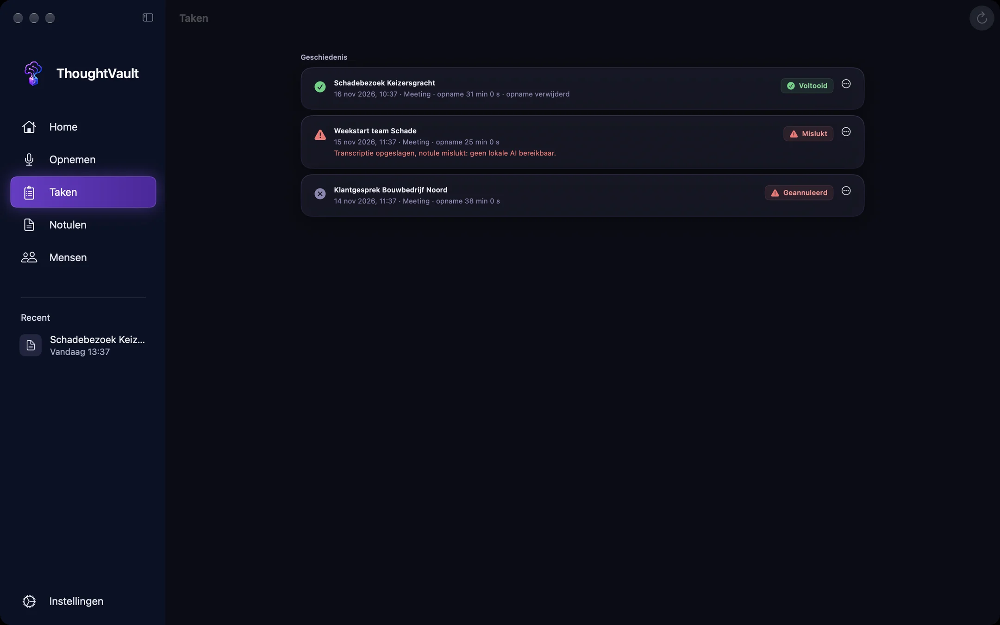
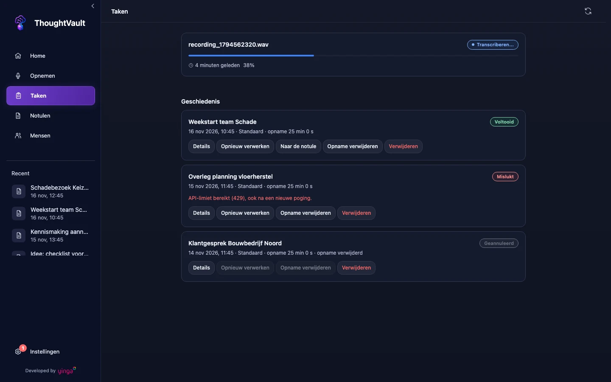
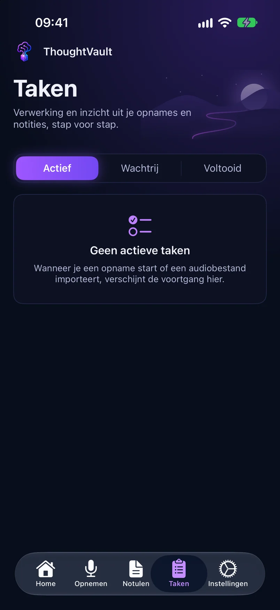

groep: Opnemen en verwerken
samenvatting: Je volgt hoe ver de verwerking van een opname is, bekijkt eerdere taken met hun details en verwerkt, hernoemt of verwijdert een taak.

# Taken

Elke opname die je stopt en elk audiobestand dat je importeert wordt een taak. Een taak zet eerst de audio om naar tekst en laat daarna de notulen schrijven. Het scherm **Taken** toont bovenaan de taken die nu lopen. Daaronder staat **Geschiedenis**: elke taak die klaar is, mislukt of geannuleerd, ook na het herstarten van de app. De app bewaart de laatste 200 taken.

::: macos

Is er nog nooit een taak geweest, dan zie je **Geen actieve taken** met de knoppen **Start een opname** en **Audiobestand importeren**, en drie kaarten met de stappen die een taak doorloopt: **Transcriberen**, **Concept schrijven** en **Controleren**.
:::

::: windows

:::

::: ios

:::

## Wat je per taak ziet

::: macos
Elke lopende taak toont de naam van het audiobestand, hoe lang geleden de taak is gestart (bijvoorbeeld **Zojuist** of **5 minuten geleden**), de status en een voortgangsbalk. Een taak die klaar is, krijgt de status **Voltooid** en schuift na drie seconden door naar **Geschiedenis**. De notulen staan dan bij **Notulen**.

Dezelfde voortgang staat in een smalle balk bovenaan het venster, op elk scherm. Je hoeft **Taken** dus niet open te houden.
:::

::: windows
Elke kaart toont de titel of bestandsnaam, een statuslabel, hoe lang geleden de taak is gestart en de voortgang in procenten. Tijdens het schrijven van de notulen staat onder de titel de stap die op dat moment loopt.
:::

::: ios
Bovenaan kies je tussen **Actief**, **Wachtrij** en **Geschiedenis**. Elke kaart toont de voortgang in procenten en de stap die loopt. Tik op een lopende taak voor het scherm **Verwerken**, met de stappen **Transcriptie**, **Notulen genereren** en **Notulen opslaan** onder elkaar. Trek de lijst omlaag om te verversen.
:::

## De fasen van een taak

Bij lokale verwerking, de standaard, doorloopt een taak twee fasen.

::: macos ios
| Status | Wat er gebeurt |
|--------|----------------|
| **Transcriberen** | De audio wordt op je apparaat omgezet naar tekst. Loopt er al een transcriptie, dan staat er **Wacht op vorige transcriptie**. |
| Een stapnaam, zie hieronder | Het AI-model schrijft en controleert de notulen. |
| **Voltooid** | De notulen zijn opgeslagen. |
| **Fout** | De taak is gestopt met een fout. |
:::

::: windows
| Status | Wat er gebeurt |
|--------|----------------|
| **Transcriberen...** | De audio wordt op je pc omgezet naar tekst. |
| **Notulen genereren...** | Het AI-model schrijft en controleert de notulen. Onder de titel staat de stapnaam. |
| **Voltooid** | De notulen zijn opgeslagen. |
| **Mislukt** | De taak is gestopt met een fout. |
:::

De transcriptie wordt opgeslagen zodra ze klaar is, dus voordat de notulen worden geschreven. Mislukt het schrijven, dan hoeft de opname niet opnieuw te worden getranscribeerd.

Staat de verwerking op **Cloud**, dan zie je andere statussen, zoals **Uploaden**, **Converteren**, **In wachtrij** en **Verwerken**: de opname gaat dan naar de server en wordt daar verwerkt.

## De stapnamen bij het schrijven van de notulen

Het schrijven van notulen bestaat uit meerdere verzoeken aan het AI-model. De taak toont welk verzoek loopt.

| Stapnaam | Wat het model doet |
|----------|--------------------|
| **Concept schrijven** | De eerste versie van de notulen schrijven op basis van de transcriptie en je profiel. |
| **Samenvatten 2 van 5** | Een transcriptie die te lang is voor het model eerst in delen samenvatten. Het tweede getal is het aantal delen. |
| **Broncontrole** | Nagaan of de transcriptie zelf goed te volgen is. Deze controle start tegelijk met het concept en levert hoogstens een waarschuwing bij de notulen op. |
| **Inhoudscontrole** | In twee richtingen vergelijken: staat wat is gezegd in de notulen, en is wat in de notulen staat ook gezegd. |
| **Dekkingscontrole 3 van 8** | Bij een lang gesprek: per deel van de transcriptie nagaan of de notulen het dekken. |
| **Controle 12 van 61** | Bij een lang gesprek: de zinnen uit de notulen een voor een naast de transcriptie leggen. De teller telt afgeronde controles en loopt alleen op. |
| **Contextsuggesties** | Uit het gesprek voorstellen afleiden voor termen en personen. |

Hoeveel controles er zijn, hangt af van de lengte van het gesprek. Een taak die lang op **Controle** staat is dus niet vastgelopen zolang de teller oploopt. Een enkel verzoek aan het model mag hoogstens 900 seconden duren.

De inhoudscontrole en de controles voor lange gesprekken houden verzonnen of weggelaten punten tegen. Keuren ze het concept af, dan wordt het niet als notule opgeslagen. De foutmelding eindigt dan met **Het concept is apart bewaard voor beoordeling; er is geen nieuwe goedgekeurde notule opgeslagen.**

## Geschiedenis en details

Elke taak in **Geschiedenis** toont de titel, de datum, het profiel, de lengte van de opname en de uitkomst: **Voltooid**, **Mislukt**, **Geannuleerd** of **Onderbroken**. Onderbroken betekent dat de app stopte terwijl de taak liep. Bij een mislukte taak staat de foutmelding eronder.

::: macos ios
Klik of tik op een taak voor de details. Het menu met de drie puntjes naast de taak, of een rechtsklik (Mac) of lang drukken (iPhone), geeft dezelfde acties zonder de details te openen.
:::

::: windows
Klik op **Details** bij de taak. De knoppen voor de andere acties staan direct op de kaart.
:::

De details tonen:

- wanneer de taak startte en klaar was, en hoe lang de verwerking duurde;
- de stappen, zoals **Transcriberen** en **Concept schrijven**, met de duur van elke stap;
- welke spraakherkenning en welke aanbieder en welk model de notulen schreven, zoals ingesteld bij de start van de taak;
- of de opname nog op je apparaat staat en of er een notule is opgeslagen.

## Een taak opnieuw verwerken

Kies **Opnieuw verwerken** bij een taak in **Geschiedenis**. In het venster stel je drie dingen in:

1. **Titel**: de naam van de notule. Met **Titel opslaan** wijzig je alleen de titel, zonder opnieuw te verwerken.
2. **Profiel**: het profiel dat de opbouw van de notule bepaalt.
3. **Model**: een van de aanbevolen modellen van de aanbieder die je bij **Instellingen** > **Verwerking** hebt gekozen. Je keuze wordt daar ook je standaardmodel.

Klik daarna op **Opnieuw verwerken**. De taak verschijnt weer bovenaan bij de lopende taken.

::: macos ios
Is de transcriptie al opgeslagen, dan schrijft de app alleen de notule opnieuw. De bestaande notule wordt pas vervangen als de nieuwe versie door de inhoudscontrole komt. Is er nog geen transcriptie, dan begint de taak bij het transcriberen. Daarvoor moet de opname nog op je apparaat staan.
:::

::: windows
Opnieuw verwerken gebruikt de opname, die moet dus nog op je pc staan. Bij een mislukte taak hergebruikt de app een transcriptie die al was opgeslagen. Bij een voltooide taak maakt de app een nieuwe notule en blijft de bestaande notule staan.
:::

### Welke modellen je kunt kiezen

Bij een aanbieder waarvoor je een eigen API-sleutel invult, betaal je per verwerkt woorddeel (token). De app toont daar alleen aanbevolen modellen die hoogstens $3 per miljoen invoertokens en $15 per miljoen uitvoertokens kosten. Duurdere modellen staan niet in de lijst. Achter elk model staat de prijs. Voor een model op je eigen computer of een abonnement met een vast bedrag betaal je niet per token, daar geldt geen grens.

::: windows
Dezelfde lijst staat bij **Instellingen** > **Verwerking** onder **Model** voor aanbieders met een eigen API-sleutel. Stond er een duurder model ingesteld, dan zie je dat als **(boven de prijsgrens)** en kies je een van de aanbevolen modellen. Tot je dat doet, gebruikt de app het eerste aanbevolen model van die aanbieder en meldt dat in de details van de taak.
:::

## Naar de notule

Kies **Naar de notule** om de notule van een voltooide taak te openen bij **Notulen**. De knop staat er alleen als de notule nog bestaat. Bij een taak waarvan alleen de transcriptie is opgeslagen opent hij die transcriptie.

## De opname verwijderen

Kies **Opname verwijderen** om het audiobestand van een taak van je apparaat te halen, bijvoorbeeld als de notule klaar is en je geen geluid wilt bewaren. Na bevestiging is het bestand definitief weg. De notule en de transcriptie blijven staan. In de details staat daarna **Opname: Verwijderd**, en **Opnieuw verwerken** werkt alleen nog als de transcriptie is opgeslagen. Heb je de opname eerder opnieuw verwerkt, dan gebruiken meerdere taken hetzelfde bestand; bij al die taken staat de opname daarna op **Verwijderd**.

## Een taak annuleren of verwijderen

::: macos
Een lopende taak stop je met het kruisje (**Annuleren**) en daarna **Annuleer taak**. De taak komt in **Geschiedenis** met de uitkomst **Geannuleerd**.
:::

::: ios
Houd een lopende taak ingedrukt en tik op **Annuleren**. Op het scherm **Verwerken** stop je de taak met **Annuleren** en daarna **Annuleer verwerking**.
:::

::: windows
Bij lokale verwerking kun je een lopende taak op dit scherm niet annuleren. Bij verwerking via **Cloud** staat bij een lopende taak de knop **Annuleren**.
:::

Met **Taak verwijderen** haal je een taak uit **Taken**, ook uit **Geschiedenis**. Je kiest in het venster **Taak verwijderen** tussen:

- **Alleen taak verwijderen**: de taak verdwijnt, de notule en de opname blijven bewaard.
- **Taak en notule verwijderen**: de notule bij **Notulen** gaat ook weg. Deze knop staat er alleen als er een notule is.

Het audiobestand blijft in beide gevallen staan bij **Opgeslagen opnames** op het scherm [Opnemen](opnemen.html#opgeslagen-opnames). Wil je ook dat kwijt, gebruik dan eerst **Opname verwijderen**.

## Veelvoorkomende foutmeldingen

| Melding | Wat je doet |
|---------|-------------|
| **Transcriptie opgeslagen, notule mislukt: geen lokale AI bereikbaar.** (Mac, iPhone en iPad) | Er draait geen model op het ingestelde adres. Start Ollama of LM Studio, of kies bij **Instellingen** > **Verwerking** een andere aanbieder. Start de taak daarna opnieuw. |
| **Tijdslimiet bereikt: de AI-provider gaf niet op tijd een volledig antwoord.** | Start de taak opnieuw, of kies een sneller model. |
| **API-limiet bereikt (429), ook na een nieuwe poging.** (Windows) | De aanbieder beperkt het aantal verzoeken. Wacht even en start de taak opnieuw, of verwerk minder opnames tegelijk. |
| **Het antwoord van de AI-provider is afgebroken omdat het de maximale lengte bereikte.** (Windows) | Start de taak opnieuw. Blijft het terugkomen, kies dan een ander model. |
| **Geannuleerd door gebruiker.** (Mac, iPhone en iPad) | Je hebt de taak zelf gestopt. Verwijder de taak of kies **Opnieuw verwerken**. |

Bij een fout stuurt de app automatisch een foutrapport naar de ontwikkelaar, zonder je opname, transcriptie of notulen. Meer oorzaken en oplossingen staan in [Problemen oplossen](problemen-oplossen.html).
