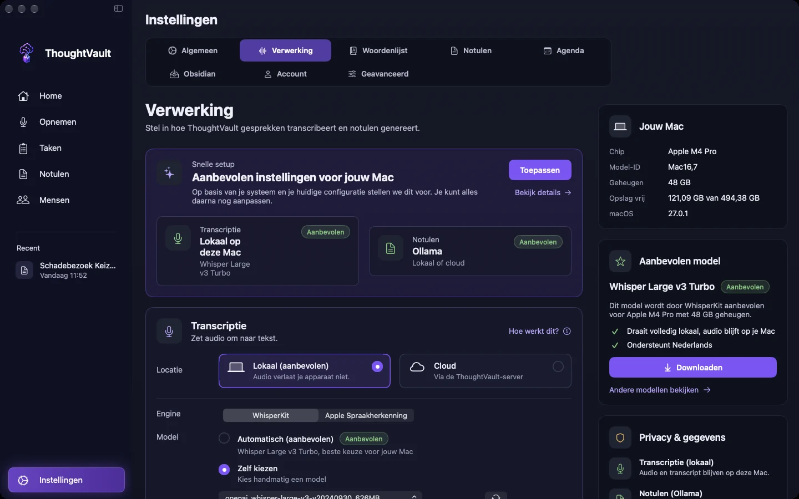
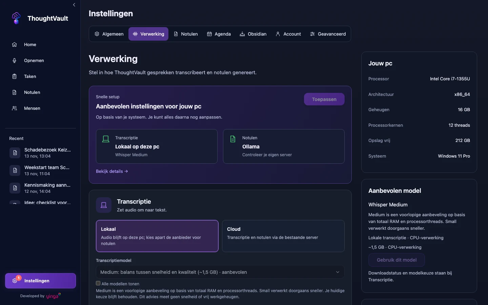

groep: Opnemen en verwerken
samenvatting: Je kiest waar je opname wordt verwerkt en weet wat daarbij je apparaat verlaat en wat zonder internet werkt.

# Lokaal of via de cloud verwerken

Bij **Instellingen** > **Verwerking** staan twee keuzes die samen bepalen waar je gegevens heen gaan: waar de opname wordt omgezet naar tekst (**Transcriptie**) en welk AI-model de notulen schrijft (**Notulen**). Standaard staat de transcriptie op lokaal.

::: macos

:::

::: windows

:::

## Transcriptie: lokaal of cloud

::: macos
| Keuze | Wat er met de opname gebeurt |
|-------|------------------------------|
| **Lokaal (aanbevolen)** | De opname wordt op je Mac omgezet naar tekst. De audio verlaat je apparaat niet. |
| **Cloud** | De opname wordt geüpload naar de ThoughtVault-server. Die maakt de transcriptie en ook de notulen. |

Bij **Lokaal** kies je de engine: **WhisperKit**, waarvoor eenmalig een model wordt gedownload, of **Apple Spraakherkenning**, dat direct werkt zonder download.
:::

::: windows
| Keuze | Wat er met de opname gebeurt |
|-------|------------------------------|
| **Lokaal** | De opname wordt op je pc omgezet naar tekst. De aanbieder voor de notulen kies je apart. |
| **Cloud** | De opname wordt geüpload naar de ThoughtVault-server. Die maakt de transcriptie en ook de notulen. |

Bij **Lokaal** download je eenmalig het transcriptiemodel. Het blok **Snelle setup** stelt een model voor dat bij je pc past: met **Toepassen** neem je dat voorstel over.
:::

::: ios
In **Instellingen** staat bij **Verwerking** de huidige keuze: **Lokaal op dit apparaat** of **Cloud (server)**. Bij lokaal blijft de audio op je iPhone of iPad.
:::

Voor **Cloud** heb je een ThoughtVault-account nodig.

::: windows
Kies je **Cloud** zonder ingelogd te zijn, dan opent het inlogscherm. Met **Lokaal gebruiken zonder account** ga je daar terug naar lokale verwerking.
:::

## Notulen: welk model krijgt de transcriptie

Het model dat de notulen schrijft, krijgt de tekst van de transcriptie en je eventuele notitie. De audio gaat nooit naar dit model.

| Aanbieder | Waar gaat de transcriptie heen |
|-----------|--------------------------------|
| Ollama of LM Studio op je eigen computer | Nergens: alles blijft op je apparaat |
| Ollama of LM Studio op een andere computer of server | Naar die server |
| De overige aanbieders in de lijst, met je eigen API-sleutel | Naar die aanbieder. Het gebruik kost apart tegoed bij die aanbieder. |

::: macos ios
**Apple Intelligence** staat ook in de lijst op apparaten die het ondersteunen. Dat model draait op het apparaat zelf.
:::

::: windows
De kaart **Privacy & gegevens** op dit scherm vat in twee zinnen samen wat er met jouw huidige keuzes gebeurt, voor transcriptie en voor notulen. API-sleutels bewaart de app in Windows Credential Manager.
:::

Staat de transcriptie op **Cloud**, dan valt er niets te kiezen: de server schrijft de notulen.

## Wat werkt zonder internet

Bij lokale transcriptie heb je alleen internet nodig voor wat je zelf naar buiten stuurt.

| Onderdeel | Zonder internet |
|-----------|-----------------|
| Opnemen | Werkt altijd |
| Transcriberen, lokaal | Werkt, zodra het transcriptiemodel is gedownload |
| Notulen met een model op je eigen computer | Werkt |
| Notulen met een aanbieder op internet | Werkt niet. De transcriptie wordt wel opgeslagen en je start de taak later opnieuw. |

Mislukt het schrijven van de notulen omdat de aanbieder niet bereikbaar is, dan staat de taak als mislukt op het scherm [Taken](taken.html#een-mislukte-taak-opnieuw-starten). Je start hem opnieuw zodra de verbinding terug is.

### Zonder verbinding in de modus Cloud

::: macos ios
Stop je een opname terwijl er geen verbinding is, dan meldt de app: **Geen verbinding. Opname opgeslagen en wordt automatisch geüpload zodra je weer online bent.** De opname staat intussen bij **Opgeslagen opnames**.
:::

::: windows
Opnames die niet geüpload konden worden, komen in een wachtrij die de app zelf opnieuw probeert. Lukt het na meerdere pogingen niet, dan verschijnt een melding met de bestandsnaam en het advies om naar **Opgeslagen opnames** te gaan en het daar handmatig te proberen.
:::

## Wat alleen in de modus Cloud bestaat

- [YouTube-transcriptie](youtube-transcriptie.html), als de beheerder van de server die heeft aangezet.
- Op Mac, iPhone en iPad: meelopende tekst tijdens het opnemen. Zie [Live tekst tijdens de opname](opnemen.html#live-tekst-tijdens-de-opname).
- Op Windows: de wizard bij de eerste start en de optie **Premium model** op het scherm **Opnemen**.

## Wisselen tussen lokaal en cloud

1. Open **Instellingen**.
2. Ga naar **Verwerking**.
3. Kies onder **Transcriptie** de gewenste locatie.

De wijziging geldt voor de volgende opname. Alle instellingen op dit scherm staan beschreven in [Instellingen](instellingen.html).
