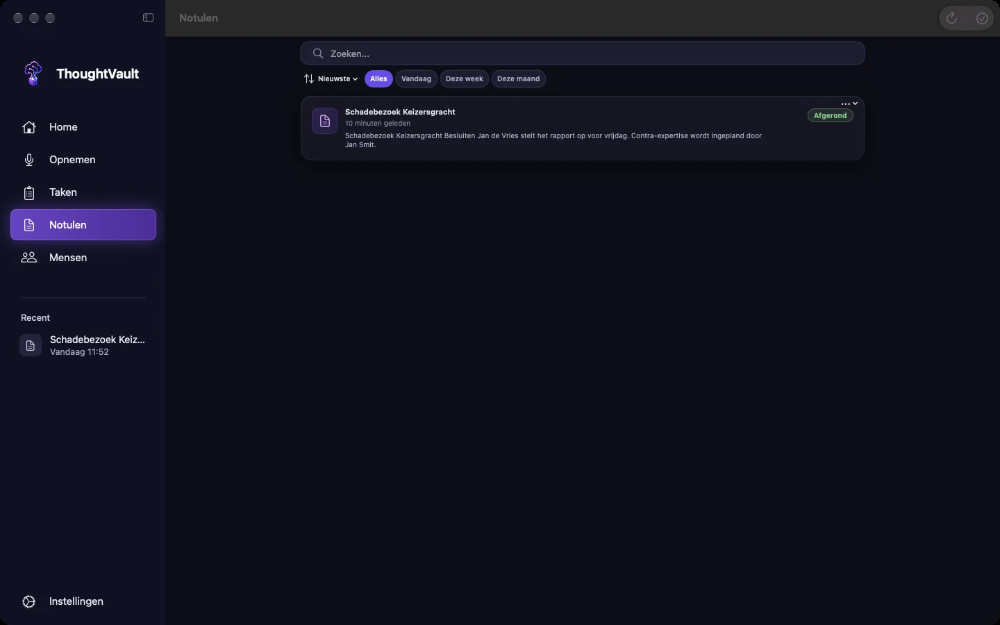
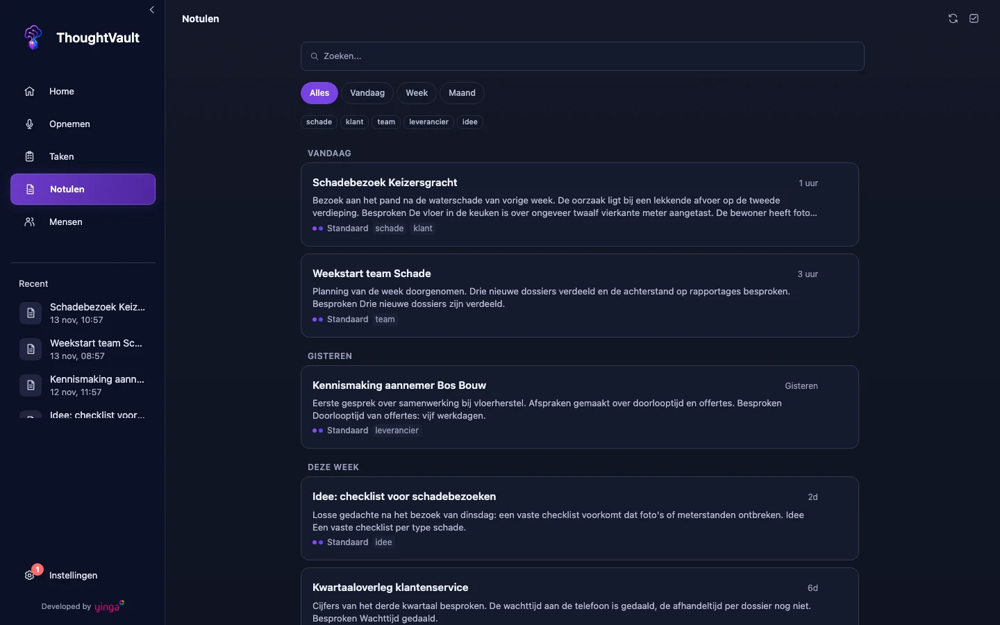

groep: Notulen
samenvatting: Vind een notule terug, lees en bewerk hem, laat hem opnieuw maken met een ander profiel en exporteer of verwijder hem.

# Notulen

Op het scherm **Notulen** staan al je verwerkte opnames: de notule en de transcriptie waar hij uit is gemaakt. Je opent het scherm via **Notulen** in de navigatie.

::: macos
De sneltoets is `Cmd+4`.
:::

::: windows
De sneltoets is `Ctrl+4`.
:::

::: macos

:::
::: windows

:::

## Een notule terugvinden

Typ in het zoekveld. ThoughtVault zoekt in de titel, in de tekst van de notule, in de transcriptie en in de tags.

::: macos
Onder het zoekveld staan de datumfilters **Alles**, **Vandaag**, **Deze week** en **Deze maand**. Deze week betekent de afgelopen zeven dagen, deze maand de afgelopen maand. Met het sorteermenu ernaast wissel je tussen **Nieuwste eerst** en **Oudste eerst**. Hebben je notulen tags, dan staan die als knoppen onder de filters: klik op een tag om alleen notulen met die tag te zien.

De knop **Vernieuwen** rechtsboven laadt de lijst opnieuw.
:::

::: ios
Boven de lijst kies je tussen **Alles**, **Vandaag** en **Deze week**. Het menu **Filters** naast het zoekveld bevat **Periode** (met ook **Deze maand**) en **Tags**. Met **Wis tags** haal je het tagfilter weg. Rechts boven de lijst wissel je de volgorde tussen **Meest recent** en **Oudste eerst**.
:::

::: windows
Onder het zoekveld staan de filters **Alles**, **Vandaag**, **Week** en **Maand**. Hebben je notulen tags, dan staan die eronder: klik op een tag om alleen notulen met die tag te zien. De lijst is gegroepeerd onder **Vandaag**, **Gisteren**, **Deze week** en **Eerder**.

Met `Ctrl+F` spring je naar het zoekveld. De knop **Vernieuwen** naast de titel laadt de lijst opnieuw.

Elke regel toont de titel, het begin van de tekst, het profiel en de eerste twee tags. De twee stippen geven aan of er een notule en een transcriptie is.
:::

## Een notule openen en lezen

Klik of tik op een regel in de lijst. Bovenaan staat de titel met daaronder de datum en de duur van de opname.

Is er zowel een notule als een transcriptie, dan wissel je met twee knoppen tussen beide. Is er alleen een transcriptie, dan zie je die direct.

::: macos windows
De knoppen heten **Notule** en **Transcriptie**. Onder de titel staat ook het profiel waarmee de notule is gemaakt. Bij de transcriptie staat een knop **Kopieer** die de volledige tekst op het klembord zet.
:::

::: ios
De knoppen heten **Notule** en **Transcript**.
:::

Heb je tijdens de opname een notitie getypt, dan vind je die terug bij de opname.

::: macos ios
De notitie staat boven de transcriptie, onder **Notitie tijdens opname**.
:::

::: windows
De notitie staat boven de notule, onder **Snelle notitie bij deze opname**. Klik erop om hem uit te klappen.
:::

## De titel aanpassen

ThoughtVault haalt de titel uit de notule. Zo wijzig je hem zelf:

1. Klik of tik op de titel boven de notule.
2. Typ de nieuwe titel.
3. Druk op Enter.

::: windows
Met `Esc` annuleer je de wijziging.
:::

De knop **Titel** zoekt in de koppen en de vetgedrukte tekst van de notule naar een andere titel en vult die in. De knop werkt alleen als er een notule is.

## De notule bewerken

1. Open de notule.
2. Klik of tik op **Bewerken**.
3. Pas de tekst aan.
4. Kies **Opslaan**. Met **Annuleren** gooi je de wijzigingen weg.

::: macos ios
Tijdens het bewerken staat boven de tekst een opmaakbalk voor vet, cursief, onderstreept, een lijst met opsommingstekens en een genummerde lijst. In het menu met de tekstgrootte kies je **Kop 1**, **Kop 2**, **Kop 3**, **Paragraaf** of **Citaat**.
:::

::: macos windows
Staat een naam of term steeds verkeerd in de notule, gebruik dan **Woord corrigeren**. Dat vervangt het woord in de hele notule en onthoudt de juiste spelling voor volgende opnames. Zie [Woordenlijst](woordenlijst.html#een-woord-corrigeren-vanuit-een-notule).
:::

## Opnieuw genereren met een ander profiel

Past de notule niet bij het gesprek, of is er alleen een transcriptie, laat de notule dan maken uit de transcriptie die er al is. Je hoeft niets opnieuw op te nemen.

::: macos
1. Open de notule.
2. Klik op **Regenereer**.
3. Klik onder **Kies een profiel** op het profiel dat je wilt gebruiken.
:::

::: ios
1. Open de notule.
2. Tik op **Regenereren**.
3. Tik onder **Kies een profiel** op het profiel dat je wilt gebruiken.
:::

::: windows
1. Open de notule en klik op **Regenereer**. Of klik in de lijst met de rechtermuisknop op de notule en kies **Regenereer notulen**.
2. Kies in het venster **Notulen regenereren** het profiel.
3. Klik op **Regenereren**.
:::

Is de nieuwe notule klaar, dan vervangt hij de oude, inclusief titel en profielnaam. Wat je met de hand in de oude notule had gewijzigd, zit niet in de nieuwe. Wat een profiel is en welke er zijn, lees je in [Profielen](profielen.html).

## Controles op de notule

Maakt de app de notule zelf, dus met de verwerking op **Lokaal**, dan controleert hij het resultaat voordat je het te zien krijgt. Tijdens het genereren zie je de stappen voorbijkomen bij de lopende taak:

| Stap | Wat er gebeurt |
|------|----------------|
| **Concept schrijven** | Het model schrijft de notule uit de transcriptie. |
| **Broncontrole** | De app beoordeelt of de transcriptie zelf goed te volgen is, zonder de notule erbij. |
| **Inhoudscontrole** | De beweringen in de notule worden naast de transcriptie gelegd, en andersom: staat wat er gezegd is ook in de notule? |

Bij een lang gesprek wordt het werk in delen geknipt. Je ziet dan tellers zoals **Samenvatten 2 van 5**, **Dekkingscontrole 3 van 8** en **Controle 12 van 61**.

Een controle houdt de notule nooit tegen. Vindt de app iets, dan staat dat onderaan de notule in een sectie **Even nalopen**. Daar kunnen deze regels staan:

- "Een deel van de opname was lastig te verstaan. Kijk namen, getallen en afspraken even na."
- "We konden niet nagaan of de opname goed te verstaan was. Lees de notule daarom even kritisch door."
- "We konden niet automatisch controleren of alles in de notule klopt. Kijk feiten, acties en afspraken even na."
- Een bevinding met het citaat erachter. Die begint met "Dit is gezegd, maar staat misschien niet in de notule", "Dit stuk van de opname was niet goed te volgen", "Dit staat in de notule, maar is misschien niet zo gezegd", "Dit klopt misschien niet met wat er is gezegd" of "Dit is misschien niet helemaal goed samengevat".

Leg bij zo'n bevinding het citaat naast de transcriptie en pas de notule aan met **Bewerken**. De sectie **Even nalopen** is gewone tekst in de notule: hij gaat mee in een export en je kunt hem na het nalopen zelf weghalen.

Staat er geen sectie **Even nalopen**, dan heeft de controle niets gevonden. Een garantie is dat niet: de controle wordt door een AI-model uitgevoerd en kan fouten missen.

Bij een notule uit een eerdere versie van de app kan boven de tekst een blok staan waarvan de kop met **Concept** begint. Toen bewaarde de app een afgekeurd concept apart. Klap het blok uit om de reden en het concept te lezen. De notule eronder is de goedgekeurde versie.

## Exporteren, afdrukken en kopiëren

::: macos
Klik in de geopende notule op het deelpictogram. Het menu bevat:

| Optie | Wat het doet |
|-------|--------------|
| **Delen...** | Opent het deelvenster van macOS. |
| **PDF** | Opent het afdrukvenster op A4. Kies daar een printer of bewaar als PDF. |
| **Markdown** | Maakt een Markdown-bestand van de notule. |
| **Exporteer naar Obsidian** | Schrijft de notule naar je Obsidian-vault. |
| **Haal op uit Obsidian** | Haalt de versie uit Obsidian terug naar ThoughtVault. |
| **Platte tekst** | Slaat de notule op als tekstbestand (.txt). |
| **Kopieer tekst** | Zet de tekst van het tabblad dat je voor je hebt op het klembord. |

Afdrukken kan ook met `Cmd+P` of via **Afdrukken…** in de menubalk, zolang er een notule open staat.
:::

::: ios
Tik in de geopende notule op **Exporteren**. Je kiest uit **PDF**, **Markdown**, **Exporteer naar Obsidian**, **Haal op uit Obsidian**, **Platte tekst** en **Kopieer tekst**. Met het deelpictogram rechtsboven deel je de notule via het deelvenster van iOS.
:::

::: windows
Klik in de geopende notule op **Export**. Het menu bevat:

| Optie | Wat het doet |
|-------|--------------|
| **PDF** | Opent het afdrukvenster. Kies een printer, of een pdf-printer om een bestand te bewaren. |
| **Markdown** | Slaat de notule op als Markdown-bestand. |
| **HTML** | Slaat de notule op als HTML-bestand met de titel erboven. |
| **Naar Obsidian** | Schrijft de notule naar je Obsidian-vault. |
| **Uit Obsidian** | Haalt de versie uit Obsidian terug naar ThoughtVault. |
| **TXT** | Slaat de notule op als tekstbestand. Is er alleen een transcriptie, dan wordt die opgeslagen. |
| **Kopieer tekst** | Zet de tekst van de notule op het klembord. |

Klik je in de lijst met de rechtermuisknop op een notule en kies je **Exporteren**, dan opent het afdrukvenster voor de notule. Is er alleen een transcriptie, dan wordt die als tekstbestand opgeslagen.
:::

### Obsidian

De twee Obsidian-opties werken als de koppeling is ingesteld bij [Instellingen](instellingen.html), onderdeel **Obsidian**. Staat daar **Automatisch exporteren naar Obsidian** aan, dan schrijft ThoughtVault de notule ook naar je vault nadat je hem hebt bewerkt en opgeslagen.

Heb je de notule in Obsidian aangepast, haal die versie dan terug met de optie om uit Obsidian op te halen. Wijkt hij af van de notule in ThoughtVault, dan vraagt de app eerst om bevestiging, want de versie uit Obsidian vervangt de huidige notule.

## Tags

Tags staan onder de titel van een notule en werken als filter in de lijst.

::: windows
Zo beheer je de tags van een notule:

1. Open de notule en klik op **Tags**. Of klik in de lijst met de rechtermuisknop op de notule en kies **Tags**.
2. Typ een naam bij **Nieuwe tag...** en klik op **Toevoegen**, of klik onder **Beschikbaar** op een tag die je al eerder hebt gebruikt.
3. Klik op het kruisje achter een tag om hem te verwijderen.
4. Klik op **Sluiten**.
:::

## Verwijderen

Verwijderen is definitief. De notule en de transcriptie verdwijnen allebei.

::: macos
Klik in de lijst met de rechtermuisknop op een notule en kies **Verwijderen**, of gebruik het menu **Meer opties** op de regel. Bevestig met **Verwijderen**.

Meerdere tegelijk verwijderen:

1. Klik rechtsboven op **Selectiemodus**.
2. Klik de notulen aan die weg moeten.
3. Klik op **Verwijder** met het aantal erachter.
4. Bevestig je keuze.

Met **Klaar** verlaat je de selectiemodus zonder iets te verwijderen.
:::

::: ios
Houd een notule in de lijst ingedrukt en kies **Verwijderen**. Bevestig je keuze.

Meerdere tegelijk verwijderen:

1. Tik op **Filters** en kies **Selecteren**.
2. Tik de notulen aan die weg moeten.
3. Tik op **Verwijder** met het aantal erachter.
4. Bevestig je keuze.

Met **Stoppen** verlaat je de selectie zonder iets te verwijderen.
:::

::: windows
Klik in de geopende notule op het prullenbakpictogram en bevestig met **Verwijderen**.

Let op bij de andere twee routes: die vragen niet om bevestiging.

- Rechtermuisknop op een notule in de lijst, dan **Verwijderen**: de notule is direct weg.
- **Selectiemodus** naast de titel: vink notulen aan, of klik op **Alles**, en klik op **Verwijder**. Alle aangevinkte notulen zijn direct weg.
:::
