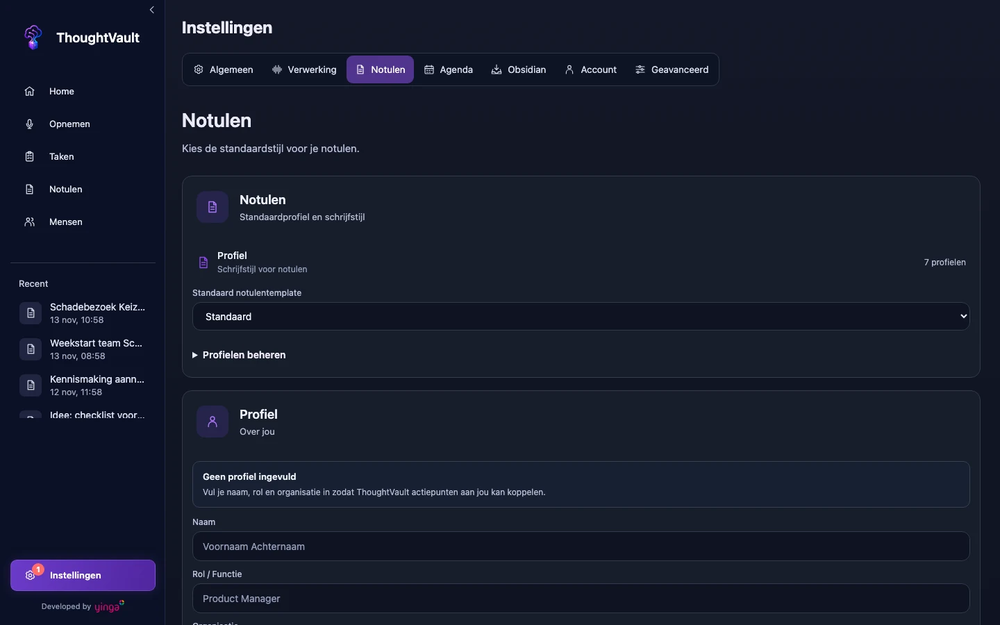

groep: Notulen
samenvatting: Kies het profiel dat bij je gesprek past, stel een standaardprofiel in en maak een eigen profiel met je eigen instructie en secties.

# Profielen

Een profiel is de opdracht die het AI-model meekrijgt bij het schrijven van de notule: welke onderdelen erin komen, hoe uitgebreid en in welke toon. Dezelfde transcriptie levert met het profiel **Executive** een korte beslisnotitie op en met **Projectoverleg** een overzicht per werkstroom.

Je kiest een profiel voordat je opneemt (zie [Opnemen](opnemen.html)) en je kunt een bestaande notule opnieuw laten maken met een ander profiel (zie [Notulen](notulen.html#opnieuw-genereren-met-een-ander-profiel)).

## Ingebouwde profielen

| Profiel | Wat je krijgt |
|---------|---------------|
| **Standaard** | Evenwichtige notulen met onderwerpen, besluiten en vervolgwerk |
| **Executive** | Compacte beslisnotitie voor leidinggevenden |
| **Projectoverleg** | Voortgang, blokkades en opvolging per werkstroom |
| **Klantgesprek** | Klantbehoefte, afspraken en terugkoppeling |
| **1-op-1** | Persoonlijk gesprek met aandacht voor context en opvolging |
| **Brainstorm** | Ideeën, afwegingen en kansen zonder schijnbesluiten |
| **Promptnotitie** | Zet gesproken of geïmporteerde tekst om in een kopieerbare prompt |

Ingebouwde profielen kun je niet bewerken of verwijderen. Wil je er een aanpassen, maak dan een eigen profiel.

## Waar je profielen beheert

::: macos
Ga naar **Instellingen**, tabblad **Verwerking**, en klik onder de notuleninstellingen op **Eigen profielen beheren**. Het scherm **Profielen** toont **Standaard profielen** en daaronder **Aangepaste profielen**.
:::

::: ios
Ga naar **Instellingen** en tik op **Opnameprofielen**. Het scherm **Profielen** toont bovenaan het **Geselecteerd profiel** en daaronder de **Overige profielen**.
:::

::: windows
Ga naar **Instellingen**, tabblad **Notulen**, en klap **Profielen beheren** uit. Je ziet **Standaard profielen** en daaronder **Mijn profielen**.
:::

::: windows

:::

## Een standaardprofiel instellen

Het standaardprofiel staat al geselecteerd wanneer je een nieuwe opname begint. Je kunt per opname nog een ander profiel kiezen.

::: macos
1. Ga naar **Instellingen**, tabblad **Notulen**.
2. Kies onder **Profielen** een profiel bij **Standaard profiel**.

Met **Geen standaard** laat je de keuze open.
:::

::: ios
1. Ga naar **Instellingen** en tik op **Opnameprofielen**.
2. Tik bij het profiel dat je wilt gebruiken op **Kies**.

Het profiel schuift naar **Geselecteerd profiel**. Je kunt ook een profiel ingedrukt houden en **Kies als standaard** kiezen.
:::

::: windows
1. Ga naar **Instellingen**, tabblad **Notulen**.
2. Kies een profiel bij **Standaard notulentemplate**.

In de lijst onder **Profielen beheren** kan het ook: klik bij een profiel op het sterpictogram (**Instellen als standaard**). Het gekozen profiel krijgt het label **Standaard**.
:::

## Een eigen profiel maken

::: macos
1. Open het scherm **Profielen** en klik op **Nieuw**.
2. Vul het profiel in (zie de velden hieronder).
3. Klik op **Opslaan**.
:::

::: ios
1. Open het scherm **Profielen** en tik op **Profiel toevoegen**.
2. Vul het profiel in (zie de velden hieronder).
3. Tik op **Opslaan**.
:::

::: windows
1. Klap **Profielen beheren** uit en klik op **Nieuw profiel**.
2. Vul het profiel in (zie de velden hieronder).
3. Klik op **Opslaan**.
:::

Het nieuwe profiel staat daarna in de profielkeuze bij het opnemen en bij het opnieuw genereren.

### De velden

**Naam** en **Wat moet er in de notulen staan?** zijn verplicht. De rest mag je leeg laten.

| Veld | Wat je invult |
|------|---------------|
| **Naam** | Hoe het profiel in de lijst heet, bijvoorbeeld Standup of Klantgesprek. |
| **Stijl** | De toon: **Zakelijk**, **Informeel** of **Technisch**. |
| **Wat moet er in de notulen staan?** | Je instructie in gewone taal: welke onderdelen je wilt, de toon en hoeveel detail. Bijvoorbeeld: "Maak een beknopte samenvatting met actiepunten en besluiten. Gebruik een informele toon." |
| **Secties** | De koppen van de notule, gescheiden door komma's. Bijvoorbeeld: Onderwerpen, Acties, Open vragen. |
| **Rol van de AI** | Staat onder **Geavanceerde opties**. Laat leeg voor de standaardrol die bij de gekozen stijl hoort. Vul het in als het model vanuit een bepaalde expertise moet schrijven. |

::: macos ios
Een sectie waar het gesprek niets voor oplevert, wordt weggelaten uit de notule.
:::

::: windows
Windows heeft drie velden extra: **Beschrijving** (de regel onder de naam in de lijst), **Icoon (emoji)** en onder **Geavanceerde opties** een **HTML-sjabloon** voor wie de opmaak van de notule zelf wil vastleggen. **Rol van de AI** kan maximaal 5000 tekens bevatten.
:::

## Een eigen profiel bewerken of verwijderen

Een wijziging geldt voor notulen die je daarna maakt. Bestaande notulen veranderen niet, ook niet als je het profiel verwijdert.

::: macos
Klik in het scherm **Profielen** bij een aangepast profiel op het potlood om het te bewerken, of op de prullenbak om het te verwijderen. Bevestig het verwijderen met **Verwijderen**.
:::

::: ios
Tik bij het profiel op **Kies**. Onder **Profiel bewerken** staan dan de regels **Rol**, **Stijl**, **Secties** en **Inhoud**: tik er een aan om het profiel te bewerken. Met **Profiel verwijderen** haal je het weg. Je kunt een profiel ook ingedrukt houden en **Bewerken** of **Verwijderen** kiezen.
:::

::: windows
Klik onder **Mijn profielen** bij een profiel op het potlood (**Bewerken**) of de prullenbak (**Verwijderen**). Het verwijderen vraagt om bevestiging en kan niet ongedaan worden gemaakt.
:::

## Waar je profielen staan

Staat de verwerking op **Lokaal**, dan blijven je eigen profielen op het apparaat waarop je ze hebt gemaakt. Een profiel dat je op je Mac maakt, staat dus niet vanzelf op je pc of iPhone.

::: windows
Staat de verwerking op **Cloud**, dan staan je profielen bij je account. Je kunt ze dan delen:

- Klik bij een eigen profiel op de wereldbol (**Maak publiek**) om het voor andere gebruikers zichtbaar te maken. Met het slotje (**Maak prive**) draai je dat terug.
- Klik onder **Community** op **Browse publieke profielen** om profielen van anderen te bekijken. Met het kopieerpictogram (**Kopieer naar mijn profielen**) neem je er een over.
:::

## Niet verwarren met je eigen profiel

In de instellingen staat ook een onderdeel **Over jou** met je naam, rol en organisatie. Dat is geen notulenprofiel: het vertelt de app wie jij bent, zodat actiepunten aan jou gekoppeld kunnen worden. Zie [Mensen](mensen.html#je-eigen-gegevens).
