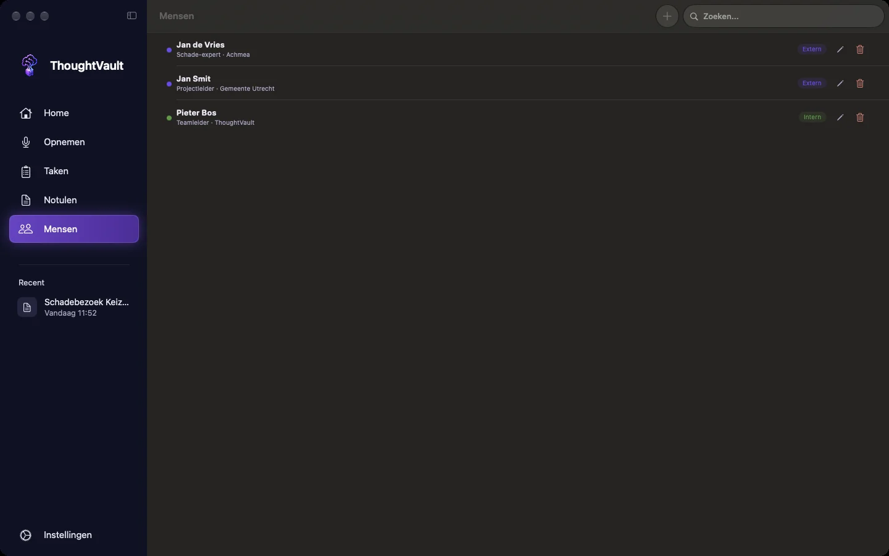
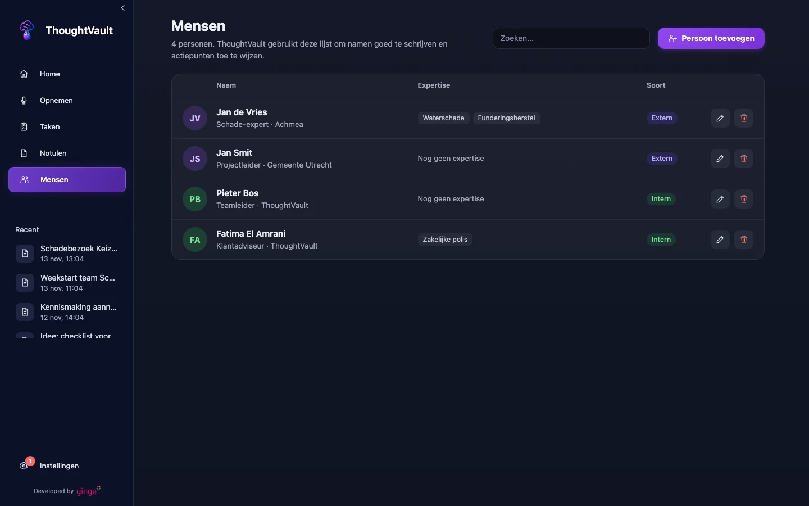

groep: Notulen
samenvatting: Leg vast wie er aan je gesprekken deelnemen, koppel deelnemers aan een opname en zet een eerdere versie van iemands gegevens terug.

# Mensen

**Mensen** is je eigen lijst met collega's en bekende externen. ThoughtVault gebruikt de lijst op twee manieren: de namen van de deelnemers die je bij een opname kiest komen in de notule, en actiepunten kunnen aan die personen worden gekoppeld. Aliassen helpen daarbij: staat "MK" als alias bij Michel Knoop, dan weet de app over wie het gaat.

::: macos
Je opent het scherm via **Mensen** in de zijbalk of met `Cmd+5`.
:::

::: ios
Je opent het scherm via **Instellingen**, onder **Organisatie**, **Mensen**.
:::

::: windows
Je opent het scherm via **Mensen** in de zijbalk of met `Ctrl+5`.
:::

::: macos

:::
::: windows

:::

## Een persoon toevoegen

1. Klik of tik op **Persoon toevoegen**.
2. Vul minimaal de **Naam** in.
3. Vul de overige velden in voor zover je ze weet.
4. Kies **Persoon toevoegen**.

| Veld | Waarvoor |
|------|----------|
| **Naam** | De volledige naam zoals hij in de notule moet staan. Verplicht. |
| **Rol / Functie** | Bijvoorbeeld Projectmanager. |
| **Organisatie** | Het bedrijf of de afdeling. |
| **Aliassen** | Andere manieren waarop iemand genoemd wordt: voornaam, bijnaam, initialen. Scheid ze met komma's. |
| **Expertise / onderwerpen** | Waar iemand over gaat, gescheiden door komma's. |
| **Intern / extern** | **Intern**, **Extern** of **Onbekend**. |
| **Taken en verantwoordelijkheden** | Typ een taak bij **Nieuwe taak** en kies **Toevoegen**. Herhaal dat per taak. Een taak die er al staat, wordt niet dubbel toegevoegd. |

::: macos
Op de Mac worden aliassen en expertise losse labels: typ een waarde en druk op Enter of een komma. Met het kruisje op een label haal je hem weg. Het venster heeft twee kolommen: links de gegevens, rechts de taken, de geschiedenis en de gesprekken.
:::

::: macos ios
Bij **Rol / Functie**, **Organisatie** en **Expertise / onderwerpen** stelt de app waarden voor die je al bij andere personen hebt gebruikt.
:::

## Een persoon zoeken, bewerken of verwijderen

Het zoekveld zoekt in namen, aliassen en e-mailadressen.

::: macos windows
Bovenaan staat hoeveel personen er in de lijst staan. Elke regel toont de initialen, de naam, de rol en organisatie, de expertise als labels (of **Nog geen expertise**) en het label **Intern**, **Extern** of **Onbekend**. Is het venster smal, dan staan de labels onder de naam.
:::

::: macos ios
Kies het potlood om iemand te bewerken en sla op met **Wijzigingen opslaan**. Met de prullenbak verwijder je de persoon. De app vraagt om bevestiging.
:::

::: ios
Elke regel toont de naam, de rol en organisatie en het label **Intern**, **Extern** of **Onbekend**.
:::

::: windows
Klik op een regel of op het potlood om de persoon te bewerken en sla op met **Wijzigingen opslaan**, of sluit met **Annuleren**.

Verwijderen: klik op de prullenbak en bevestig in de regel met **Verwijderen**.
:::

Een verwijderde persoon verdwijnt uit de lijst en uit de deelnemerskeuze. Bestaande notulen veranderen niet.

## Deelnemers koppelen aan een opname

Voor of tijdens een opname geef je aan wie erbij is.

::: macos windows
1. Ga naar **Opnemen**.
2. Klik op **Deelnemers kiezen**.
3. Vink aan wie aanwezig is. Met het zoekveld vind je iemand op naam, organisatie of alias.
4. Klik op **Gereed**.

Op het opnamescherm staat daarna het aantal gekozen personen.
:::

::: ios
1. Ga naar **Opnemen**.
2. Tik op **Deelnemers**.
3. Tik aan wie aanwezig is.
4. Tik op **Gereed**.
:::

De gekozen namen gaan mee naar de notule. Is de lijst nog leeg, dan zie je **Nog geen personen in de directory**: voeg dan eerst mensen toe.

### Deelnemers uit je agenda

::: macos windows
Hoort de opname bij een afspraak uit je gekoppelde agenda en staan er genodigden in die je nog niet in **Mensen** hebt, dan verschijnt na het stoppen van de opname het venster **Nieuwe deelnemers gevonden**. De app maakt van elk e-mailadres een naam: jan.devries@voorbeeld.nl wordt Jan Devries.

1. Haal het vinkje weg bij wie je niet wilt toevoegen.
2. Klik op **Voeg 2 personen toe** (het getal volgt je selectie), of op **Overslaan** om niemand toe te voegen.

De toegevoegde personen krijgen de status **Onbekend** en alleen een naam en e-mailadres. Loop ze daarna na in **Mensen** en corrigeer de naam waar nodig.
:::

### Koppelen na het gesprek

Maakt de app de notule zelf, dan zoekt hij na afloop in het gesprek naar personen. Herkent hij iemand uit je lijst zonder twijfel aan naam of alias, dan vult hij bij die persoon de onderwerpen en taken uit dit gesprek aan. Een nieuwe rol, een andere organisatie of een nieuwe schrijfwijze van de naam wordt nooit vanzelf overgenomen: die krijg je als voorstel boven de notule. Dat geldt ook voor personen die nog niet in je lijst staan. Zie [Voorstellen na een gesprek](woordenlijst.html#voorstellen-na-een-gesprek).

::: macos ios
Onder **Gesprekken** in het bewerkvenster van een persoon staan de opnames waaraan hij of zij gekoppeld is, met datum en titel.
:::

## Geschiedenis en herstellen

Elke wijziging aan een persoon bewaart de vorige versie. Je vindt ze onder **Geschiedenis** in het bewerkvenster, de nieuwste bovenaan, met datum, tijd en herkomst:

| Herkomst | Betekenis |
|----------|-----------|
| **Handmatig** | Je hebt de persoon zelf bewerkt. |
| **Uit gesprek** | De app heeft na een gesprek gegevens aangevuld. |
| **Voorstel** | Je hebt een voorstel boven een notule overgenomen. |
| **Hersteld** | Je hebt een eerdere versie teruggezet. |

Zo zet je een versie terug:

1. Open de persoon.
2. Zoek onder **Geschiedenis** de versie die je terug wilt.
3. Kies **Herstel**.

De velden tonen direct de teruggezette gegevens. De versie die je verving, komt zelf ook in de geschiedenis, dus terugzetten kun je weer ongedaan maken. Per persoon blijven de laatste 50 versies bewaard. Bij een persoon die je net hebt toegevoegd staat **Nog geen eerdere versies**.

## Je eigen gegevens

Jij staat zelf niet in **Mensen**. Je eigen gegevens vul je in bij **Over jou**, zodat de app actiepunten aan jou kan koppelen en jou niet als nieuwe persoon voorstelt.

::: macos
Ga naar **Instellingen**, tabblad **Notulen**, onderdeel **Over jou**.
:::

::: ios
Ga naar **Instellingen** en tik op **Over jou**.
:::

::: windows
Ga naar **Instellingen**, tabblad **Notulen**, onderdeel **Over jou**.
:::

Vul **Naam**, **Rol / Functie** en **Organisatie** in. Bij **Hoe noemen collega's jou?** zet je de namen waarmee je in gesprekken wordt aangesproken, gescheiden door komma's. **Typische vergadertypen** en **Expertise / onderwerpen** zijn optioneel. Sla op met **Profiel opslaan**.
