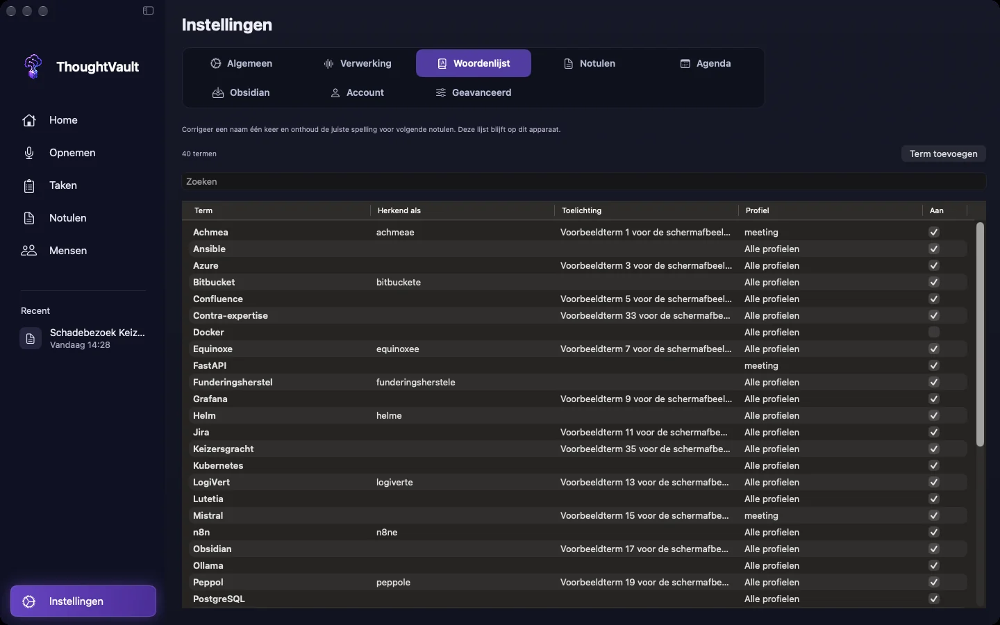
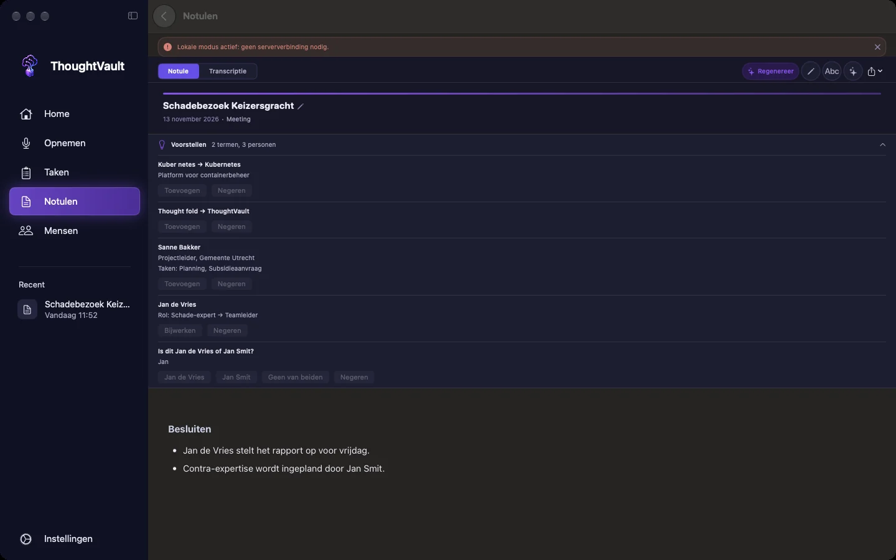

groep: Notulen
samenvatting: Leer de app hoe namen en vaktermen gespeld worden, corrigeer een woord vanuit een notule en verwerk de voorstellen die na een gesprek verschijnen.

# Woordenlijst

Spraakherkenning schrijft namen en vaktermen op zoals ze klinken. "Yinga" wordt "Jengo", een klantnaam krijgt elke keer een andere spelling. In de woordenlijst leg je per term de juiste schrijfwijze vast, met de foute varianten erbij. De lijst blijft op het apparaat waarop je hem bijhoudt.

::: macos
Je vindt de lijst bij **Instellingen**, tabblad **Woordenlijst**.
:::

::: ios
Je vindt de lijst bij **Instellingen**, **Woordenlijst**.
:::

::: windows
Je vindt de lijst bij **Instellingen**, tabblad **Verwerking**, onder de kop **Woorden en namen**.
:::

::: macos

:::

## Wat de woordenlijst doet

Bij het maken van een notule vervangt de app elke foute variant door de juiste term: in de tekst die naar het AI-model gaat en in de notule zelf. Alleen hele woorden worden vervangen en hoofdletters maken geen verschil. De variant "Jengo" raakt dus ook "jengo", maar niet "Jengolaan".

De termen en hun toelichting gaan ook als achtergrond mee naar het model, zodat het weet dat een woord een klantnaam of een product is.

De opgeslagen transcriptie zelf blijft zoals hij is herkend. Notulen die je al had, veranderen niet door een nieuwe term. Wil je een bestaande notule bijwerken, gebruik dan **Woord corrigeren** in die notule of laat hem opnieuw genereren.

## Een term toevoegen

1. Kies **Term toevoegen**.
2. Typ bij **Correcte term** de juiste schrijfwijze.
3. Typ bij **Verkeerde spellingen (komma-gescheiden)** de varianten die de spraakherkenning ervan maakt.
4. Vul eventueel een **Toelichting (optioneel)** in, bijvoorbeeld "Klant uit Utrecht". Maximaal 200 tekens: de teller onder het veld laat zien hoeveel je over hebt.
5. Kies bij **Toepassen op** voor **Alle opnames** of voor één profiel.
6. Kies **Opslaan**.

### Alle opnames of één profiel

Met **Alle opnames** wordt elke passende vermelding vervangen, in elk gesprek. Dat gaat mis bij een variant die ook een gewoon woord is. Kies in dat geval het profiel waarbij de term speelt: de vervanging geldt dan alleen voor notulen die met dat profiel worden gemaakt. In de lijst staat in de kolom **Profiel** dan de profielnaam, anders **Alle profielen**.

## Termen bekijken, bewerken en uitzetten

De lijst staat op alfabet en toont per term de varianten (**Herkend als**), de toelichting en het profiel. Zodra er termen zijn, verschijnt een zoekveld dat zoekt in term, varianten en toelichting.

::: macos
Dubbelklik op een term om hem te bewerken, of klik met de rechtermuisknop en kies **Bewerken**. Met de schakelaar in de kolom **Aan** zet je een term tijdelijk uit zonder hem te verwijderen.
:::

::: ios
Tik op een term om hem te bewerken. Zet in het bewerkvenster de schakelaar **Aan** uit om de term tijdelijk niet toe te passen. In de lijst staat er dan **Uit** bij.
:::

::: windows
Klik op een regel om de term te bewerken. Met het vinkje in de kolom **Aan** zet je een term tijdelijk uit zonder hem te verwijderen.
:::

Een term die uit staat, wordt niet toegepast en blijft in de lijst staan.

Verwijderen doe je in het bewerkvenster met **Verwijderen**. De app vraagt daarbij niet om bevestiging.

### Een eerdere versie terugzetten

In het bewerkvenster van een bestaande term staat **Geschiedenis**: de eerdere versies met datum en tijd, de nieuwste bovenaan. Kies **Herstel** bij de versie die je terug wilt. Per term blijven de laatste 50 versies bewaard.

## Een woord corrigeren vanuit een notule

::: macos windows
Zie je in een notule een verkeerd gespelde naam, dan corrigeer je hem daar en zet je hem in dezelfde handeling in de woordenlijst.

1. Open de notule en selecteer het verkeerde woord.
2. Klik op **Woord corrigeren**. Het geselecteerde woord staat al bij **Verkeerde spellingen**.
3. Typ de juiste schrijfwijze bij **Correcte term**.
4. Controleer **Toepassen op**. Daar staat het profiel van deze notule al ingevuld. Kies **Alle opnames** als de term overal geldt.
5. Laat **Onthouden voor volgende opnames** aan staan om de term in de woordenlijst te zetten. Zet het uit als je alleen deze notule wilt verbeteren.
6. Klik op **Corrigeren**.

De app vervangt het woord in de hele notule en slaat de notule op.
:::

::: ios
Op iPhone en iPad corrigeer je een woord via een voorstel boven de notule (zie hieronder) of door de term toe te voegen in **Instellingen**, **Woordenlijst**.
:::

## Voorstellen na een gesprek

Maakt de app de notule zelf, dan vraagt hij het AI-model daarna om in het gesprek te zoeken naar termen die waarschijnlijk verkeerd zijn verstaan en naar personen die genoemd zijn. Wat hij vindt, staat boven de notule in de balk **Voorstellen**, met een teller zoals "2 termen, 1 persoon". Klik of tik op de balk om hem uit te klappen. Tijdens het bewerken van de notule is de balk verborgen.

::: macos

:::

Elk voorstel handel je apart af. Een afgehandeld voorstel verdwijnt, en de balk verdwijnt als er geen meer over zijn.

### Een term

Een termvoorstel toont wat er gehoord is met een pijl naar de vermoedelijk juiste term, soms met een toelichting.

- **Toevoegen** opent het venster **Woord corrigeren** met de term al ingevuld. Pas hem zo nodig aan en kies **Corrigeren**. De notule wordt verbeterd en de term komt in je woordenlijst.
- **Negeren** haalt het voorstel weg. De app stelt deze term daarna niet meer voor.

### Een persoon

Er zijn drie soorten voorstellen voor personen:

| Wat je ziet | Wat het betekent | Wat je kunt doen |
|-------------|------------------|------------------|
| Een naam met rol, organisatie of taken | Iemand die nog niet in **Mensen** staat. | **Toevoegen** opent het venster om de persoon toe te voegen, met de gevonden gegevens ingevuld. |
| De naam van iemand uit je lijst, met regels als "Rol: Teamleider" of "Ook bekend als: ..." | De app heeft in het gesprek een nieuwe rol, organisatie of schrijfwijze gehoord. | **Bijwerken** neemt precies de getoonde wijzigingen over. |
| Een vraag als "Is dit Jan de Vries of Jan Smit?" | De naam past bij meer dan één persoon. | Kies de juiste naam. Is het geen van hen, kies dan **Geen van beiden** of **Geen van deze**: het voorstel verandert in een nieuwe persoon. |

Bij elk voorstel staat ook **Negeren**. Daarmee verdwijnt het voorstel en komt het niet terug.

Wijzigingen via een voorstel komen in de geschiedenis van de persoon te staan en zijn daar terug te draaien. Zie [Mensen](mensen.html#geschiedenis-en-herstellen).

### Als er geen voorstellen zijn

Geen balk betekent dat er niets gevonden is, of dat de voorstellen al zijn afgehandeld. In sommige gevallen slaat de app de stap over en staat de reden op de plek van de balk:

- Het gesprek is langer dan 64.000 tekens. Splits de opname als je voorstellen wilt.

::: macos ios
- Het gesprek is te lang voor het gekozen model. Kies een model met meer ruimte en laat de notule opnieuw maken.
- De notule is gemaakt met Apple Intelligence. Dat model wordt niet voor voorstellen gebruikt. Kies een ander model om voorstellen te krijgen.
:::
