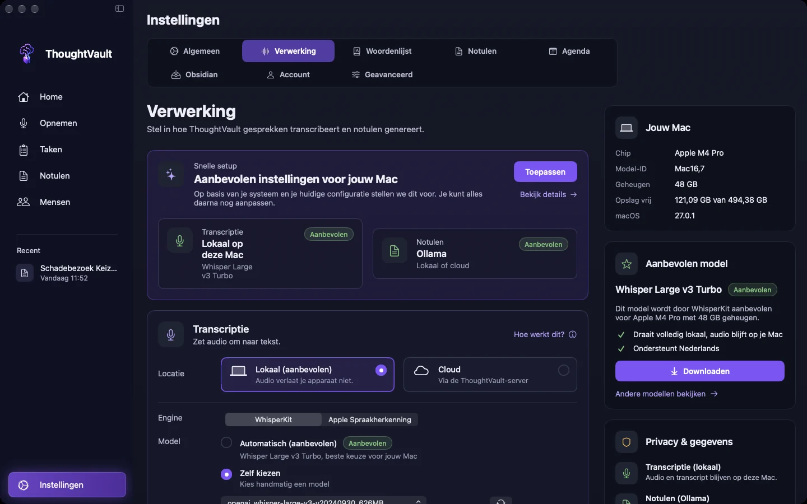
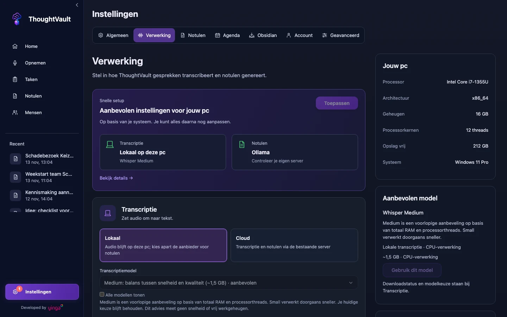

groep: Instellingen
samenvatting: Kies of je audio op je eigen apparaat of in de cloud wordt getranscribeerd, en welke aanbieder de notulen schrijft.
beeld: media/mac-instellingen-verwerking.webp

# Instellingen

In **Instellingen** bepaal je twee dingen die de uitkomst van elke opname raken: waar de audio tekst wordt, en welke aanbieder daar notulen van maakt. Dit hoofdstuk gaat over die twee keuzes. De andere tabbladen staan in [Overige instellingen](overige-instellingen.html).

::: macos
Klik in de zijbalk op **Instellingen** of druk op `Cmd+6`. Het scherm opent op het tabblad **Verwerking**. De tabbladen zijn **Algemeen**, **Verwerking**, **Woordenlijst**, **Notulen**, **Agenda**, **Obsidian**, **Account** en **Geavanceerd**.
:::

::: windows
Klik in de zijbalk op **Instellingen** of druk op `Ctrl+6`. Het scherm opent op het tabblad **Verwerking**. De tabbladen zijn **Algemeen**, **Verwerking**, **Notulen**, **Agenda**, **Obsidian**, **Account** en **Geavanceerd**.
:::

::: ios
Tik onderin op **Instellingen**. Je ziet groepen met rijen: **Opname**, **Notulen generatie**, **Agenda**, **Integraties**, **Organisatie** en **Account**. Elke rij opent een eigen pagina. De keuzes voor transcriptie en notulen staan onder **Notulen generatie** > **Verwerking**.
:::

## Verwerking: lokaal of cloud

Een opname gaat door twee stappen. Eerst wordt de audio omgezet naar tekst (transcriptie), daarna schrijft een taalmodel de notulen op basis van die tekst. Voor beide stappen kies je zelf waar het gebeurt.

| Keuze | Wat er gebeurt | Wat je nodig hebt |
|-------|----------------|-------------------|
| **Lokaal** | De audio wordt op je eigen apparaat omgezet naar tekst en verlaat het apparaat niet. Voor de notulen kies je apart een aanbieder. | Een transcriptiemodel op je apparaat en een aanbieder voor notulen |
| **Cloud** | De opname wordt geüpload naar de ThoughtVault-server, die transcriptie en notulen maakt. | Een ThoughtVault-account waarmee je inlogt, zie [Account](account.html) |

Lokaal is de standaard. Daarmee blijft de audio op je apparaat. Of het transcript je apparaat verlaat, hangt af van de aanbieder voor notulen: zie [Wat verlaat je apparaat](#wat-verlaat-je-apparaat).

::: macos

:::
::: windows

:::

## Aanbevolen instellingen toepassen

::: macos
Bovenaan **Verwerking** staat het blok **Snelle setup** met de titel **Aanbevolen instellingen voor jouw Mac**. Het toont twee voorstellen: bij **Transcriptie** staat **Lokaal op deze Mac** met het model dat bij je chip en geheugen past, bij **Notulen** een aanbieder.

1. Klik op **Bekijk details** als je wilt lezen waarom dit model is gekozen.
2. Klik op **Toepassen**.

De app zet transcriptie op Lokaal met de engine WhisperKit en het aanbevolen model. Staat dat model nog niet op je Mac, dan begint de download meteen. De knop verandert in **Toegepast**.

Voor de notulen houdt de app je huidige aanbieder aan als die kan werken. Ontbreekt er een sleutel of is de aanbieder niet beschikbaar, dan wordt het Apple Intelligence als je Mac dat ondersteunt, en anders Ollama. Een cloudaanbieder kiest de app nooit voor je.

Heeft je Mac minder dan 16 GB geheugen, dan stelt de app de compacte versie van het model voor (626 MB).
:::

::: windows
Bovenaan **Verwerking** staat het blok **Snelle setup** met de titel **Aanbevolen instellingen voor jouw pc**.

1. Klik op **Bekijk details** als je de onderbouwing wilt lezen.
2. Klik op **Toepassen**.
3. Klik daarna bij **Transcriptie** op **Model downloaden**.

Toepassen zet transcriptie op Lokaal en kiest het aanbevolen model: Whisper Medium bij minstens 16 GB geheugen en 8 processorthreads, anders Whisper Small. Het model wordt niet vanzelf gedownload. Sla je stap 3 over, dan haalt de app het op bij je eerste opname. Een aanbieder met eigen API-sleutel die je al had gekozen, blijft geselecteerd.

Het advies kijkt alleen naar geheugen en processor. De app meet geen snelheid en geen vrij werkgeheugen. Rechts zie je onder **Jouw pc** de gegevens waarop het advies is gebaseerd.
:::

::: ios
Op iPhone en iPad is er geen blok met aanbevolen instellingen. Je kiest de verwerkingsmodus, de engine en de aanbieder zelf op de pagina **Verwerking**.
:::

## Transcriptie instellen

::: macos
In de kaart **Transcriptie** kies je bij **Locatie** tussen **Lokaal (aanbevolen)** en **Cloud**.

Bij Lokaal kies je een **Engine**:

- **WhisperKit** gebruikt een model dat je eenmalig downloadt. Laat **Automatisch (aanbevolen)** aan staan, of kies **Zelf kiezen** en selecteer een model uit de lijst. Modellen die al op je Mac staan, hebben de toevoeging "(geïnstalleerd)". Met de knop met de twee pijlen laad je de lijst opnieuw.
- **Apple Spraakherkenning** werkt direct, zonder download.

Rechts staat de kaart **Aanbevolen model**. De knop daarin heet **Downloaden** zolang het model ontbreekt, **Gebruik dit model** als het klaarstaat en **In gebruik** als het actief is. Achter de knop met de drie puntjes vind je **Toon in Finder** en **Verwijderen**. Het model dat in gebruik is, kun je niet verwijderen.

Bij Cloud verschijnt, als je Mac het ondersteunt, de schakelaar **Transcriptie op apparaat**. Daarmee wordt de spraak toch op je Mac omgezet en gaat er geen audio naar de server.
:::

::: windows
In de kaart **Transcriptie** kies je tussen **Lokaal** en **Cloud**.

Bij Lokaal:

1. Kies een model bij **Transcriptiemodel**. Het aanbevolen model heeft de toevoeging "aanbevolen". Vink **Alle modellen tonen** aan als het model dat je zoekt er niet tussen staat.
2. Klik op **Model downloaden**. Tijdens het downloaden zie je het percentage en de knop **Annuleren**.
3. Wacht op de melding "Model gedownload en klaar voor gebruik".

| Model | Grootte |
|-------|---------|
| Base | ongeveer 142 MB |
| Small | ongeveer 466 MB |
| Faster Whisper Small | ongeveer 486 MB |
| Parakeet TDT v3 | ongeveer 714 MB |
| Medium | ongeveer 1,5 GB |
| Large v3 | ongeveer 3 GB |

De app omschrijft Base als compact met lagere nauwkeurigheid en Large v3 als beste kwaliteit maar traag op de processor. Parakeet gebruikt je woordenlijst nog niet als hulp bij het herkennen.

Onder **Modellen beheren** staat per model **Downloaden**, of **Toon bestand** en **Verwijderen** als het al op je pc staat. Het geselecteerde model kun je niet verwijderen.

Kies je Cloud zonder dat je bent ingelogd, dan opent het inlogscherm. De tegels voor een eigen notulenaanbieder zijn in deze modus uitgeschakeld.
:::

::: ios
1. Tik op **Verwerking**.
2. Kies bij **Verwerkingsmodus** tussen **Lokaal** en **Cloud**.
3. Kies bij Lokaal een **Engine**: **WhisperKit** of **Apple**.
4. Vul bij WhisperKit een **Model** in, of tik op de knop met de twee pijlen om de beschikbare modellen te laden en er een te kiezen.

WhisperKit downloadt het gekozen model bij het eerste gebruik. Apple Spraakherkenning werkt zonder download.
:::

## De aanbieder voor notulen kiezen

De aanbieder ontvangt het transcript en schrijft de notulen. Ontbreken er feiten in je notulen, probeer dan ook een ander model en niet alleen een ander profiel.

| Aanbieder | Waar het draait | Wat je invult |
|-----------|-----------------|---------------|
| **Ollama** | Op je eigen computer of server, of bij Ollama Cloud | Adres en model. Voor Ollama Cloud ook een API-sleutel |
| **LM Studio** | Op je eigen computer of server | Adres (standaard `http://localhost:1234`) en model |
| **Apple Intelligence** | Op je Mac, iPhone of iPad | Niets |
| De overige aanbieders in de lijst | Bij een cloudaanbieder | Je eigen API-sleutel en een model |

### Ollama

1. Kies **Ollama** als aanbieder.
2. Laat het adres `http://localhost:11434` staan als Ollama op dezelfde computer draait. Kies **Cloud** voor Ollama Cloud.
3. Kies een model uit de lijst. Blijft de lijst leeg, controleer dan het adres en of Ollama draait.
4. Vul bij Ollama Cloud je API-sleutel in.
5. Test de verbinding.

::: macos ios
De testknop heet **Verbinding testen**. Mogelijke uitkomsten zijn "Verbonden", "Niet bereikbaar", "Bereikbaar, maar deze server vraagt een API-sleutel" en "API-sleutel geweigerd door de server". Een sleutel wordt alleen over HTTPS verstuurd. Vul je een sleutel in bij een adres dat met `http://` begint, dan waarschuwt de app daarvoor.
:::

::: ios
Ollama draait niet op een iPhone of iPad zelf. Vul het adres in van een Ollama-server waar je toestel bij kan.
:::

::: windows
De testknop heet **Test verbinding** en toont daarna "Verbonden" of "Niet bereikbaar". Met **Modellen vernieuwen** haal je de lijst opnieuw op.
:::

### Een cloudaanbieder met je eigen sleutel

Voor deze aanbieders heb je een API-sleutel nodig die je bij de aanbieder zelf aanmaakt. De kosten lopen via je eigen API-account bij die aanbieder. Een abonnement op de chatdienst van dezelfde aanbieder geldt hiervoor niet.

1. Kies de aanbieder.
2. Plak je sleutel in het veld voor de API-sleutel.
3. Kies of typ het model.

::: macos ios
Onder de velden staat de status: "Geen sleutel ingesteld", "Sleutel opgeslagen", "Verbonden met" gevolgd door de naam van de aanbieder, of "Sleutel geweigerd of niet bereikbaar". Met **Sleutel verwijderen** haal je de sleutel weg. De sleutel staat in de sleutelhanger van je apparaat.

Met **OpenAI-compatibel** gebruik je een aanbieder die niet in de lijst staat. Kies **Toevoegen** en vul een **Naam**, een **Adres** dat met `https://` begint, de sleutel en het model in.
:::

::: windows
Klik op **Opslaan** onder het sleutelveld. Het veld toont daarna "Sleutel opgeslagen · vul in om te vervangen". Met **Verwijderen** haal je de sleutel weg. Sleutels staan uitsluitend in Windows Credential Manager.

Apple Intelligence staat als tegel in de lijst, maar is op Windows niet beschikbaar.
:::

### Apple Intelligence

::: macos ios
Apple Intelligence schrijft de notulen op je apparaat zelf. Onder de keuze zie je of het op jouw apparaat beschikbaar is. Lange vergaderingen worden met deze aanbieder meestal als concept bewaard. Kies een cloudmodel als je gecontroleerde notulen van lange gesprekken wilt.
:::

::: macos
Op de Mac vraagt Apple Intelligence macOS 26 of nieuwer.
:::

::: windows
Apple Intelligence werkt alleen op Apple-apparaten.
:::

### Wat verlaat je apparaat

::: macos windows
De kaart **Privacy & gegevens** rechts op het tabblad **Verwerking** laat voor je huidige keuzes zien wat waar blijft.
:::

- Lokale transcriptie: de audio blijft op je apparaat.
- Ollama of LM Studio op je eigen computer: het transcript blijft daar. Staat de server ergens anders, dan gaat het transcript daarheen.
- Apple Intelligence: het transcript blijft op je apparaat.
- Een cloudaanbieder of Ollama Cloud: het transcript wordt naar die aanbieder gestuurd.
- Cloud bij Transcriptie: de audio wordt naar de ThoughtVault-server geüpload.

## De andere tabbladen

De woordenlijst, het standaardprofiel, de agenda, Obsidian, updates en permissies staan in [Overige instellingen](overige-instellingen.html). Het tabblad **Account** en het melden van problemen staan in [Account](account.html) en [Support en meldingen](support-en-meldingen.html).
