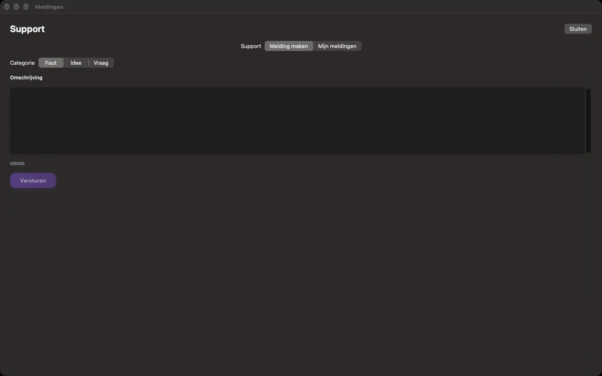
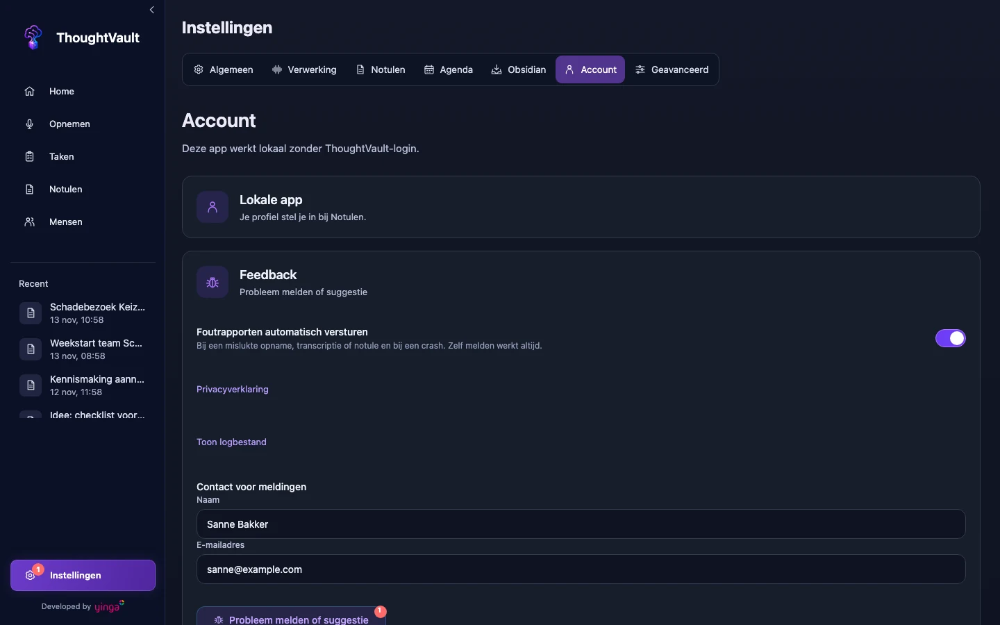

groep: Hulp
samenvatting: Stuur een fout, idee of vraag vanuit de app, lees het antwoord terug en bepaal of foutrapporten automatisch worden verstuurd.

# Support en meldingen

Vanuit de app stuur je een melding rechtstreeks naar de ontwikkelaar: een fout, een idee of een vraag. Het antwoord lees je in de app terug. Gaat er iets mis bij opnemen, transcriberen of het maken van notulen, dan verstuurt de app zelf een foutrapport, tenzij je dat uitzet.

## Je naam en e-mailadres

Bij de eerste start vraagt de app om je naam en e-mailadres. Zonder die twee kun je niet verder. Ze zijn nodig om je meldingen te beantwoorden en maken geen account aan.

::: macos
Het scherm heet **Voor wie zijn de antwoorden?**. Later pas je de gegevens aan bij **Instellingen** > **Account**, in de kaart **Contact voor meldingen**: wijzig **Naam** of **E-mailadres** en klik op **Opslaan**.
:::

::: ios
Het scherm heet **Voor wie zijn de antwoorden?**. Later pas je de gegevens aan bij **Instellingen** > **Over ThoughtVault**, in het blok **Support**: wijzig **Naam** of **E-mailadres** en tik op **Opslaan**.
:::

::: windows
Het scherm heet **Even voorstellen**. Later pas je de gegevens aan bij **Instellingen** > **Account**, onder **Contact voor meldingen**. De wijziging wordt bewaard zodra je het veld verlaat en beide velden geldig zijn.
:::

Je naam mag maximaal 200 tekens lang zijn, je e-mailadres maximaal 320.

## Een melding maken

::: macos
1. Open **Instellingen** > **Account** en klik op **Melding maken**. Het kan ook via het menu **Help** > **Melding maken…** in de menubalk.
2. Kies bij **Waar gaat je melding over?** een van de drie kaarten: **Fout** (iets werkt niet zoals het hoort), **Idee** (een wens of verbetering) of **Vraag** (je wilt weten hoe iets werkt).
3. Beschrijf bij **Omschrijving** wat je deed, wat je verwachtte en wat er gebeurde. Er passen 5000 tekens in, de teller staat onder het veld.
4. Klik rechtsonder op **Versturen**.

Boven de knop staat wat er met je melding meegaat: je naam, e-mailadres, de app-versie, je apparaat, je klikpad en een afgeschermd logbestand. Je opnames, transcripties en notulen gaan nooit mee.

Onder de knop lees je de uitkomst:

- "Verstuurd. Het antwoord zie je in Mijn meldingen en in je e-mail."
- "Geen verbinding. De melding gaat vanzelf de deur uit zodra je weer online bent."
- "Versturen lukte niet. Probeer het zo nog eens."
:::

::: ios
1. Open **Instellingen** > **Over ThoughtVault** en tik op **Melding maken**.
2. Kies een **Categorie**: **Fout**, **Idee** of **Vraag**.
3. Beschrijf bij **Omschrijving** wat er gebeurde of wat je wilt weten, in maximaal 5000 tekens.
4. Tik op **Versturen**.

Zonder verbinding bewaart de app de melding en verstuurt hij haar zodra je weer online bent.
:::

::: windows
1. Open **Instellingen** > **Account**.
2. Klik onder **Feedback** op **Probleem melden of suggestie**.
3. Kies op het tabblad **Nieuw** een **Categorie**: **Probleem**, **Suggestie** of **Vraag**.
4. Vul de **Beschrijving** in, in maximaal 5000 tekens.
5. Klik op **Versturen**.

Onderin het venster verschijnt de uitkomst: "Melding verstuurd.", of "Geen verbinding. De melding wordt verstuurd zodra er weer internet is." Lukt het versturen niet, dan blijft je tekst in het formulier staan.
:::

Met een melding gaan je naam, je e-mailadres en een technisch logbestand mee. Zet daarom geen wachtwoorden of andere gevoelige gegevens in de tekst. Een goede foutmelding noemt wat je deed, wat je verwachtte en welke tekst de app toonde.

::: macos

:::
::: windows

:::

## Antwoorden lezen

Een antwoord op je melding komt in de app en per e-mail.

::: macos
1. Open **Instellingen** > **Account** en klik op **Mijn meldingen**, of kies **Help** > **Mijn meldingen**.
2. Links staan je meldingen, elk met nummer, status en het laatste antwoord. Klik op een melding: rechts opent het gesprek, met jouw berichten rechts en die van support links.
3. Typ onderin bij **Schrijf een antwoord** je reactie en klik op **Stuur**.

Met **Vernieuwen** haal je de lijst opnieuw op. Is het venster smal, dan zie je eerst alleen de lijst; met **Terug naar Mijn meldingen** ga je vanuit een gesprek terug.
:::

::: ios
1. Open **Instellingen** > **Over ThoughtVault** en tik op **Mijn meldingen**.
2. Tik op een melding om het gesprek te openen.
3. Typ onder **Antwoord** je reactie en tik op **Stuur**.
:::

::: windows
1. Open **Instellingen** > **Account** en klik op **Probleem melden of suggestie**.
2. Ga naar het tabblad **Mijn meldingen**.
3. Klik op een melding om het gesprek te openen.
4. Typ onder **Antwoord** je reactie en klik op **Antwoord versturen**.
:::

Elke melding heeft een nummer en een status:

| Status | Betekenis |
|--------|-----------|
| **Nieuw** | De melding is binnen en nog niet opgepakt. |
| **In behandeling** | Er wordt aan gewerkt. |
| **Wacht op jou** | Er is een vraag aan je gesteld. Open de melding en antwoord. |
| **Opgelost** | De melding is afgehandeld. |
| **Gesloten** | De melding is afgesloten. |

### Het bolletje met ongelezen antwoorden

Is er een antwoord dat je nog niet hebt gelezen, dan staat er een getal bij **Instellingen** in de navigatie. In de lijst **Mijn meldingen** herken je de melding met het nieuwe antwoord aan een stip achter het nummer. Het getal verdwijnt nadat je het gesprek hebt geopend.

::: macos
Hetzelfde getal staat naast **Mijn meldingen** op het tabblad **Account**.
:::

::: windows
Hetzelfde getal staat op de knop **Probleem melden of suggestie**.
:::

## Automatische foutrapporten

De schakelaar **Foutrapporten automatisch versturen** staat standaard aan. De app verstuurt dan zelf een rapport als een opname, transcriptie of notule mislukt, en na een crash.

In zo'n rapport zit:

- de versie van de app en het type apparaat;
- je klikpad: de schermen en knoppen die je kort daarvoor gebruikte;
- een afgeschermd logbestand;
- je naam en e-mailadres, zodat de ontwikkelaar kan reageren.

Je opnames, transcripties, notulen en titels gaan nooit mee.

### Automatisch versturen uitzetten

::: macos
Open **Instellingen** > **Account** en zet **Foutrapporten automatisch versturen** uit.
:::

::: ios
Open **Instellingen** > **Over ThoughtVault** en zet **Foutrapporten automatisch versturen** uit.
:::

::: windows
Open **Instellingen** > **Account** en zet onder **Feedback** de schakelaar **Foutrapporten automatisch versturen** uit. Rapporten die nog klaarstonden om te versturen, vervallen dan.
:::

Zelf een melding maken blijft werken als de schakelaar uit staat.

## Het logbestand bekijken

Met **Toon logbestand** zie je zelf wat de app bijhoudt. De knop staat bij de andere instellingen voor support.

::: macos
Finder opent met het logbestand geselecteerd.
:::

::: ios
Het deelvenster opent, zodat je het logbestand kunt bewaren of doorsturen.
:::

::: windows
Verkenner opent met het bestand `thoughtvault.log` geselecteerd.
:::

## Privacyverklaring

De link **Privacyverklaring** staat op het scherm waar je je naam invult en bij de instellingen voor support. Hij opent de privacyverklaring van ThoughtVault in je browser.
