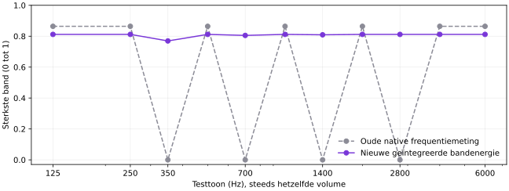

# Soundwave: berekening en verificatie

De aangeleverde Windows-video laat een kleine, bijna gelijkmatige golf zien terwijl het audioniveau uitslaat. Een schermopname zonder audiotrack bewijst geen exacte vertraging ten opzichte van geluid. Brononderzoek en vaste PCM-tests tonen twee oorzaken: gaten in de frequentiemeting en het vervangen van volume/lettergreeptiming door frequentiedata in de renderer.

## Aangetoonde meetfout

De oude Goertzel-code meet 21 losse frequenties: zeven centra met telkens factoren 0,85, 1 en 1,15. Daartussen is geen complete bandmeting. De ongewijzigde Rust-code geeft bij even luide 250-, 350-, 700- en 1.400-Hz-tonen respectievelijk 0,864, 0, 0 en 0 terug. Een afzonderlijke berekening van dezelfde Hann-probes toont voor 350 Hz circa 55 dB ondermeting ten opzichte van 250 Hz. Dit is geen volumeverschil in de testbron.



De grafiek vergelijkt de sterkste genormaliseerde band van de echte oude Rust-code met de nieuwe Swift-code bij 16 kHz, sinusamplitude 0,1 en vijftien analyseframes. Bij een bandgrens verdeelt de correcte berekening energie over twee banden; de sterkste afzonderlijke band is daar iets lager. De volledige energie blijft aanwezig.

## Berekening

Voor PCM-samples x[n] bepaalt RMS = sqrt(sum(x[n]^2)/N) het totale volume. De bestaande gekalibreerde volume-envelope en noise gate blijven behouden.

Een periodiek Hann-venster w[n] onderdrukt randlekken. De FFT analyseert alle frequentiebins van de laatste macht-van-twee samples, maximaal 4.096. De bestaande capturebuffer bevat maximaal 64 ms. Bij stabiele 16-kHz-capture zijn dat 1.024 samples (64 ms); bij 48 kHz zijn dat 2.048 samples (42,67 ms).

De zeven aaneengesloten banden hebben grenzen 80, 177, 354, 707, 1.414, 2.828 en 5.657 Hz; de hoogste band loopt door tot Nyquist. Voor iedere band:

```
P_band = sum(m[k] * |FFT(x*w)[k]|²) / (N * sum(w[n]²))
dB_band = 10 * log10(max(P_band, 1e-20))
target = clamp((dB_band + 60) / 48, 0, 1)^0.8
alpha = 1 - exp(-dt / tau)
smoothed += alpha * (target - smoothed)
```

m[k] is 2 voor gespiegeld real-input spectrum en 1 op Nyquist. De vensterenergiecorrectie bewaart het juiste vermogen. tau is 25 ms bij stijging en 140 ms bij daling. FFT-plan, Hann-venster en Windows-scratchbuffer worden hergebruikt. macOS gebruikt Accelerate; Windows gebruikt RustFFT, zodat geen eigen FFT-implementatie of tweede capturebron nodig is.

## Visualisatie

Het ontwerp blijft een gestileerde spectrale visualisatie. De hoofdgolf gebruikt de totale volume-envelope; frequentiemetingen kunnen hoorbare spraak daardoor niet vlak maken. Andere lijnen worden gewogen naar hun gemeten band en krijgen verschillende ruimtelijke golfpatronen. De gemeten verdeling tussen lage en hoge banden beïnvloedt het hoofdpatroon. De bestaande vertraagde lettergreeplobben blijven behouden. Dit is geen schatting van een exacte grondtoon in Hz.

Het opnamevenster en de widget gebruiken dezelfde aangepaste component op ieder platform. Pauze/inactiviteit blijft vlak; oude frequentiedata mag een stille volume-envelope niet laten bewegen. Clipping, beperkte widgethoogte en Reduce Motion blijven behouden.

## Verificatie

- Negatieve controle: echte oude Rust-processor geeft nul voor 350, 700 en 1.400 Hz bij een hoorbare sinusamplitude van 0,1.
- Nieuwe Swift- en Rust-tests: elf even luide tonen, waaronder die gaten, op 16, 44,1 en 48 kHz. Alle sterkste bandwaarden liggen tussen 0,68 en 0,87.
- Streaming-fixture met 1.200 Hz, 533 samples per 30-Hz-frame en een rollende 1.024-samplebuffer: native Swift-bandwaarde 0,564 na 33 ms, 0,746 na 66 ms en 0,795 na 99 ms. Na 500 ms stilte is de resterende waarde 0,028. Rust toetst dezelfde grenzen.
- Rendererregressie: hoorbaar volume blijft zichtbaar bij nul/smal spectrum; lage/hoge banden leveren verschillende paden; stale spectrum maakt stilte niet levend; compacte paden blijven binnen hun canvas en Reduce Motion blijft stabiel.
- Lokale Windows-suite: 76 frontendtests en 22 native Rust-tests slagen. Windows bevat één extra platformgebonden native test in CI.
- Dezelfde daadwerkelijke Swift-bron is afzonderlijk gecompileerd en getoetst met de 33 toon/sample-rategevallen, streamingreactie en niet-eindige PCM. Appbuild, native XCTest, uiteindelijke installers en runtimecontrole worden afzonderlijk in de releasecontrole vastgelegd.

Deze getallen meten de DSP-fixture, niet de complete hardware-naar-schermvertraging via Royal TSX. Een volledige nieuwe videomeeting en audiovisuële synchronisatietest zijn daarmee nog niet bewezen. De bronopname en meetinginhoud staan niet in de repo.

## Bronnen

- [W3C Web Audio: FFT windowing and smoothing](https://www.w3.org/TR/webaudio-1.0/#fft-windowing-and-smoothing-over-time)
- [MathWorks: bandvermogen door integratie van PSD](https://www.mathworks.com/help/signal/ref/bandpower.html)
- [MathWorks: vermogen en RMS](https://www.mathworks.com/help/signal/ug/measure-the-power-of-a-signal.html)
- [Apple Accelerate: DiscreteFourierTransform](https://developer.apple.com/documentation/accelerate/vdsp/discretefouriertransform)
- [RustFFT: herbruikbare FFT-plannen](https://docs.rs/rustfft/latest/rustfft/struct.FftPlanner.html)
